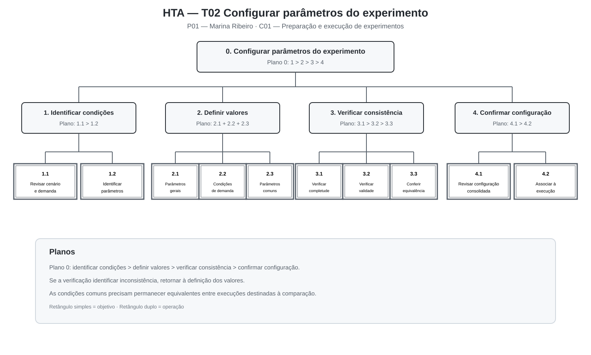
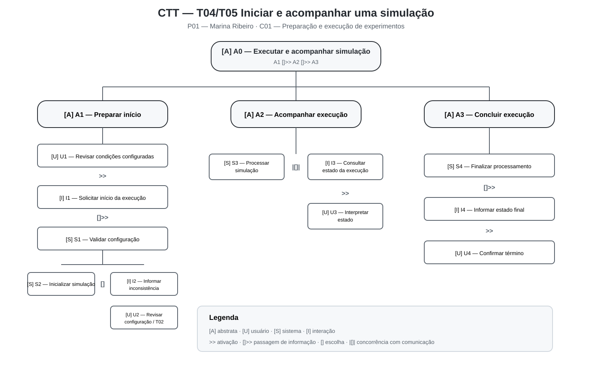

# Entrega 5 — Análise de tarefas: HTA, GOMS e CTT

**Data:** 20/10/2026  
**Status:** 🟩 concluída  
**Responsabilidade:** cada integrante modela pelo menos 1 HTA, 1 GOMS e 1 CTT. As três técnicas podem abordar a mesma funcionalidade ou funcionalidades distintas, conforme a orientação da disciplina.

## Objetivo da atividade

Modelar tarefas importantes sob perspectivas complementares: decomposição hierárquica (HTA), estrutura de metas/métodos/operações (GOMS) e relações temporais entre tarefas (CTT). O diagrama deve ser acompanhado de interpretação textual.

## Para projetos cujo TCC não previa interface

Modele **tarefas humanas relacionadas ao uso da contribuição técnica**, e não a implementação interna do algoritmo. Exemplos de boas tarefas para análise:

- investigar uma consulta de baixo desempenho;
- configurar uma análise e selecionar parâmetros;
- submeter um dataset e verificar sua validade;
- acompanhar uma execução demorada;
- comparar dois resultados/modelos;
- interpretar uma recomendação e decidir se a aceita;
- localizar uma execução anterior usando busca/filtros;
- gerar e compartilhar um relatório;
- administrar papéis/permissões quando isso for parte do trabalho real;
- revisar um alerta e registrar uma decisão.

Um CRUD pode gerar tarefas relevantes, mas “cadastrar usuário” só merece modelagem se tiver significado no domínio (papéis, validações, riscos, permissões, dependências).

## Seleção das tarefas

| ID | Tarefa | Persona/cenário de origem | Frequência/criticidade | Autor responsável |
|---|---|---|---|---|
| T02 | Configurar os parâmetros do experimento | P01 / C01 | Alta frequência e criticidade: uma configuração inconsistente pode comprometer a execução e a comparabilidade dos experimentos. | Gabriel Koiama de Rocha Lira — 22.125.067-3 |
| T03 | Selecionar a estratégia de controle correspondente à execução | P01 / C01 | Alta criticidade: selecionar uma estratégia diferente daquela prevista compromete a identificação e a comparação do experimento. | Gabriel Koiama de Rocha Lira — 22.125.067-3 |
| T04/T05 | Iniciar e acompanhar a execução da simulação | P01 / C01 | Alta frequência e criticidade: o usuário precisa iniciar o experimento configurado e compreender seu estado até a conclusão. | Gabriel Koiama de Rocha Lira — 22.125.067-3 |
| T06 | Consultar e interpretar as métricas obtidas em uma execução | P02 / C02 | Alta frequência e criticidade: as métricas fundamentam a interpretação dos resultados dos experimentos. | João Pedro Lopes Santana Villas Bôas — 22.125.065-7 |
| T07 | Comparar resultados experimentais das diferentes estratégias de controle | P02 / C02 | Alta criticidade: uma comparação inadequada pode produzir conclusões incorretas sobre o comportamento das estratégias. | João Pedro Lopes Santana Villas Bôas — 22.125.065-7 |
| T08 | Elaborar uma síntese dos resultados analisados | P02 / C02 | Alta criticidade: a síntese deve representar corretamente o conjunto das métricas e as condições experimentais consideradas. | João Pedro Lopes Santana Villas Bôas — 22.125.065-7 |

> Priorize tarefas necessárias para que o usuário alcance objetivos centrais. Não desperdice a modelagem em ações triviais isoladas, como “clicar em login”, se o objetivo relevante é maior. Da mesma forma, não modele o funcionamento interno do algoritmo como se fosse uma tarefa humana.

> Na modelagem de Gabriel, o HTA aprofunda T02, o GOMS aprofunda T03 e o CTT integra T04 e T05. Na modelagem de João, o HTA aprofunda T07, o GOMS aprofunda T06 e o CTT integra T07 e T08.

---

# Parte de Gabriel Koiama de Rocha Lira

## HTA — T02 Configurar os parâmetros do experimento

**Autor(a):** Gabriel Koiama de Rocha Lira — 22.125.067-3  
**Persona/cenário de origem:** P01 — Marina Ribeiro / C01 — Preparação e execução de experimentos sob condições comparáveis  
**Necessidade relacionada:** R02 — definir corretamente as condições da simulação antes da execução

### Descrição da tarefa

O objetivo da tarefa é configurar corretamente os parâmetros necessários para uma execução experimental, preservando as condições que devem permanecer equivalentes entre diferentes estratégias de controle.

A tarefa começa depois que o cenário de interesse foi definido e antes da seleção definitiva da estratégia e do início da simulação. Marina precisa identificar quais condições serão utilizadas, definir ou ajustar seus valores e verificar se a configuração representa corretamente o experimento planejado.

A configuração envolve informações relacionadas ao cenário, demanda e parâmetros experimentais relevantes. Antes de prosseguir, Marina precisa verificar se todos os valores necessários foram definidos e se não existe alguma inconsistência capaz de comprometer a execução ou sua comparação posterior com outros experimentos.

A tarefa termina quando a configuração é considerada completa e coerente com a condição experimental planejada.

**Entrada:** cenário definido, condição de demanda, objetivos do experimento e valores de referência necessários.  
**Resultado esperado:** conjunto de parâmetros completo, consistente e identificável para a execução planejada.

### Diagrama



*Figura 1 — HTA da tarefa T02 — Configurar os parâmetros do experimento. Fonte: elaboração da equipe.*

### Decomposição e planos

| ID | Objetivo/operação | Plano/ordem | Problema ou decisão de design observada |
|---|---|---|---|
| 0 | **Configurar os parâmetros do experimento.** | **Plano 0:** realizar 1 > 2 > 3 > 4. Se a etapa 3 identificar uma inconsistência, retornar à etapa 2. | Uma configuração incorreta pode comprometer a execução e invalidar uma comparação posterior. |
| 1 | **Identificar as condições experimentais que deverão ser configuradas.** | **Plano 1:** realizar 1.1 > 1.2. | O usuário precisa compreender quais condições pertencem ao experimento atual antes de alterar valores. |
| 1.1 | Revisar cenário e condição de demanda. | Operação. | Cenário e demanda precisam permanecer identificáveis durante a configuração. |
| 1.2 | Identificar os parâmetros relevantes para a execução. | Operação. | Excesso de parâmetros sem organização pode aumentar a possibilidade de erro. |
| 2 | **Definir os valores da configuração.** | **Plano 2:** realizar 2.1, 2.2 e 2.3 conforme os parâmetros exigidos pelo experimento. | As condições que devem permanecer equivalentes entre execuções não podem ser alteradas inadvertidamente. |
| 2.1 | Definir parâmetros gerais da simulação. | Operação. | Parâmetros gerais precisam ser apresentados de forma compreensível e associados ao experimento. |
| 2.2 | Definir as condições relacionadas à demanda. | Operação. | Uma mudança não planejada na demanda pode tornar as execuções incomparáveis. |
| 2.3 | Definir demais parâmetros experimentais comuns. | Operação. | O usuário precisa distinguir parâmetros comuns de elementos que serão modificados deliberadamente na comparação. |
| 3 | **Verificar a consistência da configuração.** | **Plano 3:** realizar 3.1 > 3.2 > 3.3. Se houver problema, retornar a 2. | Identificar erros antes da simulação reduz retrabalho e risco de resultados inválidos. |
| 3.1 | Verificar se todos os parâmetros obrigatórios foram definidos. | Operação. | Configurações incompletas não devem avançar silenciosamente para execução. |
| 3.2 | Verificar se os valores utilizados são válidos para o experimento. | Operação. | Valores incompatíveis ou inesperados precisam ser percebidos antes da execução. |
| 3.3 | Conferir se as condições comuns permanecem equivalentes às execuções de referência. | Operação. | Essa verificação é necessária para preservar a comparabilidade entre estratégias. |
| 4 | **Confirmar a configuração do experimento.** | **Plano 4:** realizar 4.1 > 4.2. | Antes de prosseguir, o usuário deve reconhecer claramente qual configuração será utilizada. |
| 4.1 | Revisar a configuração consolidada. | Operação. | Uma visão consolidada reduz a dependência de memória e conferências dispersas. |
| 4.2 | Manter a configuração associada à execução que será realizada. | Operação. | A rastreabilidade entre configuração, execução e resultado precisa ser preservada. |

### Interpretação do HTA

O HTA mostra que configurar um experimento não consiste apenas em preencher valores. Marina precisa primeiro compreender quais condições pertencem ao experimento, depois definir os valores e, principalmente, verificar sua consistência antes da execução.

A etapa 3 é especialmente importante porque representa uma oportunidade de prevenção de erros. Caso uma inconsistência seja identificada, o usuário retorna à definição dos valores antes de iniciar a simulação.

A decomposição também reforça a necessidade de distinguir as condições que devem permanecer equivalentes daquelas que são alteradas propositalmente para avaliar uma estratégia.

Para o projeto de interação, isso indica que os parâmetros precisam ser organizados de maneira compreensível, possuir validações adequadas e permanecer associados à execução que produzirá os resultados.

**Verificação do HTA:**

- O objetivo 0 representa uma meta do usuário? **Sim.**
- As subtarefas são necessárias e suficientes? **Sim, dentro do escopo de T02.**
- Os planos indicam ordem, alternativa, repetição ou condição? **Sim.**
- A decomposição parou em nível útil para projeto de interação? **Sim.**

---

## GOMS — T03 Selecionar a estratégia de controle

**Autor(a):** Gabriel Koiama de Rocha Lira — 22.125.067-3  
**Persona/cenário de origem:** P01 — Marina Ribeiro / C01 — Preparação e execução de experimentos sob condições comparáveis  
**Necessidade relacionada:** R03 — selecionar claramente qual estratégia será utilizada em cada experimento

### Goal

`G0: selecionar a estratégia de controle correspondente à execução experimental planejada`

### Nível adotado

O modelo utiliza operadores em nível semântico de interação e cognição, como consultar, identificar, examinar, selecionar, comparar, verificar e confirmar.

Não foi aplicado GOMS-KLM porque a interface ainda não possui detalhamento suficiente para estimar de forma responsável tempos de apontamento, digitação, movimentação entre teclado e mouse ou resposta do sistema.

### Métodos, operadores e regras de seleção

**Method M1 — selecionar a estratégia a partir de um plano experimental explícito**

- **OP M1.1:** consultar qual execução está sendo preparada;
- **OP M1.2:** identificar qual estratégia foi definida para essa execução;
- **OP M1.3:** examinar as estratégias disponíveis;
- **OP M1.4:** selecionar a estratégia correspondente;
- **OP M1.5:** verificar se a estratégia selecionada corresponde ao plano experimental;
- **OP M1.6:** confirmar a seleção.

**Method M2 — selecionar a estratégia pela continuidade de uma bateria comparativa**

- **OP M2.1:** examinar quais estratégias já foram executadas na condição experimental atual;
- **OP M2.2:** identificar qual estratégia ainda precisa ser executada;
- **OP M2.3:** examinar as estratégias disponíveis;
- **OP M2.4:** selecionar a estratégia identificada;
- **OP M2.5:** verificar se as demais condições experimentais permanecem inalteradas;
- **OP M2.6:** confirmar a seleção.

**Selection Rule SR1:** utilizar M1 quando a estratégia da execução atual já estiver explicitamente definida no plano experimental; utilizar M2 quando Marina estiver dando continuidade a uma sequência de execuções comparativas e precisar identificar a estratégia seguinte com base no que já foi realizado.

### Interpretação do GOMS

O modelo evidencia que o objetivo do usuário não é simplesmente escolher uma opção de uma lista, mas garantir que a estratégia escolhida corresponda ao experimento que pretende realizar.

Os métodos M1 e M2 representam dois caminhos plausíveis para atingir a mesma meta. Em uma execução planejada individualmente, Marina parte diretamente da definição experimental. Em uma bateria comparativa, ela também pode precisar considerar quais estratégias já foram executadas naquela condição.

Nos dois métodos, a verificação final é necessária para impedir que uma estratégia seja executada por engano ou que a alteração da estratégia venha acompanhada de mudanças não planejadas em outras condições.

Para a futura interação, isso reforça que a estratégia escolhida deve permanecer claramente identificável e relacionada ao restante da configuração experimental.

> Em GOMS, métodos representam sequências alternativas capazes de atingir uma meta. A regra de seleção determina em qual condição cada método é utilizado.

---

## CTT — T04/T05 Iniciar e acompanhar uma simulação

**Autor(a):** Gabriel Koiama de Rocha Lira — 22.125.067-3  
**Persona/cenário de origem:** P01 — Marina Ribeiro / C01 — Preparação e execução de experimentos sob condições comparáveis  
**Necessidade relacionada:** R04 — realizar o experimento configurado e compreender seu estado de execução

### Descrição

O CTT representa as relações temporais envolvidas na preparação imediata, início, acompanhamento e conclusão de uma execução experimental.

A tarefa abstrata principal é **executar e acompanhar a simulação**. Antes do início, Marina revisa as condições configuradas e solicita a execução. O sistema verifica a configuração e, caso ela esteja adequada, inicializa o processamento.

Se uma inconsistência for identificada, o fluxo de execução não deve prosseguir normalmente. O usuário precisa reconhecer o problema e retornar à configuração correspondente antes de realizar uma nova tentativa.

Durante a simulação, o processamento do sistema e a consulta de estado podem ocorrer de forma concorrente e comunicante: enquanto a execução continua, informações sobre seu estado podem ser consultadas por Marina.

Depois que o processamento termina, o sistema consolida o estado final e informa a conclusão para que Marina verifique se a execução terminou adequadamente.

### Diagrama



*Figura 2 — CTT das tarefas T04/T05 — Iniciar e acompanhar uma simulação. Fonte: elaboração da equipe.*

### Tipos de tarefa utilizados

- **[A] Tarefa abstrata:** representa uma composição de tarefas utilizada para organizar a decomposição.
- **[U] Tarefa do usuário:** atividade realizada pelo usuário fora do processamento automático do sistema, incluindo revisão, interpretação e decisão.
- **[S] Tarefa do sistema:** processamento realizado automaticamente pelo sistema.
- **[I] Tarefa interativa:** atividade em que ocorre diálogo entre usuário e sistema.

### Estrutura do modelo

```text
[A] A0 — Executar e acompanhar simulação
    |
    +-- [A] A1 — Preparar início
    |      |
    |      +-- [U] U1 — Revisar condições configuradas
    |      |        >>
    |      +-- [I] I1 — Solicitar início da execução
    |      |        []>>
    |      +-- [S] S1 — Validar configuração
    |               |
    |               +-- [S] S2 — Inicializar simulação
    |               +-- [I] I2 — Informar inconsistência
    |                    (S2 [] I2)
    |                         |
    |                         +-- [U] U2 — Revisar/corrigir configuração
    |                                  e retornar a T02
    |
    +-- [A] A2 — Acompanhar execução
    |      |
    |      +-- [S] S3 — Processar simulação
    |      |        |[]|
    |      +-- [I] I3 — Consultar estado da execução
    |               >>
    |               [U] U3 — Interpretar estado
    |
    +-- [A] A3 — Concluir execução
           |
           +-- [S] S4 — Finalizar processamento
           |        []>>
           +-- [I] I4 — Informar estado final
                    >>
                    [U] U4 — Confirmar término da execução
```

### Relações temporais principais

`A1 []>> A2 []>> A3`

As informações definidas e validadas durante a preparação são utilizadas pela execução, e o resultado da execução é utilizado na etapa de conclusão.

Durante A1:

`S2 [] I2`

Depois da validação, ocorre uma escolha: a configuração válida permite inicializar a simulação; uma inconsistência leva à comunicação do problema e à necessidade de revisão da configuração.

Durante A2:

`S3 |[]| I3`

O processamento da simulação e a consulta de estado podem ocorrer de forma concorrente e comunicante.

### Legenda e relações temporais usadas

| Operador/relação | Significado no diagrama | Exemplo no modelo |
|---|---|---|
| `>>` | Ativação: a segunda tarefa só pode começar após a primeira terminar. | `U1 >> I1` e `I3 >> U3`. |
| `[]>>` | Ativação com passagem de informação: a segunda tarefa ocorre após a primeira e utiliza informação produzida por ela. | `I1 []>> S1` e `S4 []>> I4`. |
| `[]` | Escolha: apenas uma das tarefas alternativas é realizada naquela condição. | Após a validação, `S2 [] I2`. |
| `|[]|` | Concorrência com comunicação: as tarefas podem ocorrer simultaneamente ou em ordens intercaladas, trocando informações. | `S3 |[]| I3`. |

### Interpretação do CTT

O CTT evidencia que iniciar uma simulação depende de uma configuração previamente preparada e validada. O processamento não deve ser tratado como uma ação isolada do restante do experimento.

A escolha após a validação representa uma ruptura importante: se a configuração estiver inconsistente, a execução não segue o fluxo normal e o usuário precisa retornar à tarefa de configuração.

Durante a execução, processamento e acompanhamento possuem relação de concorrência e comunicação. A simulação continua sendo executada pelo sistema enquanto Marina consulta informações sobre seu estado.

Por fim, a conclusão da tarefa depende de feedback sobre o estado final. O usuário precisa distinguir uma execução concluída adequadamente de uma execução interrompida ou inadequada antes de utilizar seus resultados.

---

# Parte de João Pedro Lopes Santana Villas Bôas

## HTA — T07 Comparar resultados experimentais

**Autor(a):** João Pedro Lopes Santana Villas Bôas — 22.125.065-7  
**Persona/cenário de origem:** P02 — Carlos Mendes / C02 — Interpretação e comparação de resultados experimentais  
**Necessidade relacionada:** R06 — comparar o comportamento das estratégias sob condições equivalentes

### Descrição da tarefa

O objetivo da tarefa é comparar os resultados obtidos por diferentes estratégias de controle semafórico sem perder o contexto experimental associado a cada execução.

A tarefa começa quando existem duas ou mais execuções concluídas que Carlos deseja analisar. Antes de interpretar as diferenças entre as métricas, ele precisa identificar quais execuções participarão da comparação e verificar se suas condições experimentais são suficientemente equivalentes.

A comparação considera informações como cenário, condição de demanda, estratégia executada e parâmetros relevantes, além das métricas definidas no protocolo experimental: tempo médio de espera, tamanho médio das filas, throughput e número de trocas de fase.

A tarefa termina quando Carlos consegue relacionar as diferenças observadas às respectivas estratégias, interpretar o conjunto dos indicadores e formular uma conclusão coerente com as condições em que os experimentos foram realizados.

**Entrada:** execuções concluídas, condições experimentais e métricas produzidas pelas simulações.  
**Resultado esperado:** comparação tecnicamente coerente entre as estratégias, preservando a relação entre resultados e condições experimentais.

### Diagrama


*Figura 3 — HTA da tarefa T07 — Comparar resultados experimentais. Fonte: elaboração da equipe.*

### Decomposição e planos

| ID | Objetivo/operação | Plano/ordem | Problema ou decisão de design observada |
|---|---|---|---|
| 0 | **Comparar resultados experimentais sob condições equivalentes.** | **Plano 0:** realizar 1 > 2 > 3 > 4. Se em 2 as execuções não forem consideradas comparáveis, retornar a 1. | A comparação não pode separar as métricas das condições experimentais que as produziram. |
| 1 | **Identificar as execuções que serão comparadas.** | **Plano 1:** realizar 1.1 > 1.2. | O usuário precisa reconhecer claramente quais execuções participam da comparação. |
| 1.1 | Definir a condição experimental que será analisada. | Operação. | O cenário e o objetivo da comparação precisam permanecer identificáveis. |
| 1.2 | Identificar as execuções candidatas à comparação. | Operação. | Execuções semelhantes podem ser confundidas se não houver informações suficientes para distingui-las. |
| 2 | **Verificar se as execuções são comparáveis.** | **Plano 2:** realizar 2.1 > 2.2 > 2.3. Se uma condição relevante for incompatível, retornar a 1. | Comparar condições diferentes pode produzir uma conclusão incorreta sobre as estratégias. |
| 2.1 | Conferir cenário e condição de demanda. | Operação. | Cenário e demanda precisam permanecer associados a cada execução. |
| 2.2 | Conferir os parâmetros comuns relevantes. | Operação. | Diferenças de configuração não planejadas precisam ser percebidas antes da comparação. |
| 2.3 | Verificar se as execuções foram concluídas adequadamente. | Operação. | Uma execução incompleta ou inadequada pode comprometer a análise. |
| 3 | **Analisar os indicadores de desempenho.** | **Plano 3:** analisar 3.1, 3.2, 3.3 e 3.4. A ordem de consulta não é fixa, mas todos os indicadores devem ser considerados na análise completa. | As métricas representam aspectos diferentes do experimento e não devem ser interpretadas isoladamente. |
| 3.1 | Examinar o tempo médio de espera. | Operação. | O valor precisa permanecer associado à execução e à estratégia correspondentes. |
| 3.2 | Examinar o tamanho médio das filas. | Operação. | A comparação precisa deixar perceptíveis as diferenças entre as estratégias. |
| 3.3 | Examinar o throughput. | Operação. | O throughput não deve ser interpretado sem considerar os demais indicadores. |
| 3.4 | Examinar o número de trocas de fase. | Operação. | A métrica representa um aspecto diferente do comportamento do controle e deve ser interpretada em conjunto com as demais. |
| 4 | **Formar uma síntese comparativa.** | **Plano 4:** realizar 4.1 > 4.2 > 4.3. | A conclusão deve derivar do conjunto das métricas e das condições experimentais. |
| 4.1 | Identificar diferenças relevantes entre as estratégias. | Operação. | Diferenças importantes precisam ser identificadas sem reconstrução manual de todo o experimento. |
| 4.2 | Interpretar relações ou divergências entre os indicadores. | Operação. | Uma estratégia pode apresentar comportamento melhor em uma métrica e pior em outra. |
| 4.3 | Formular uma conclusão comparativa. | Operação. | A conclusão precisa manter relação com as execuções e condições que a fundamentaram. |

### Interpretação do HTA

A decomposição mostra que comparar resultados não significa apenas colocar valores lado a lado. Antes da análise das métricas existe uma etapa crítica de verificação da comparabilidade entre as execuções.

Se cenário, demanda ou parâmetros relevantes forem diferentes sem que isso faça parte do objetivo experimental, a comparação pode atribuir à estratégia de controle uma diferença provocada por outra condição.

O HTA também mostra que a interpretação depende do conjunto das métricas. Tempo médio de espera, filas, throughput e trocas de fase representam aspectos distintos do comportamento do experimento.

Por fim, o retorno previsto no Plano 0 evidencia uma ruptura importante: quando as execuções não são comparáveis, o usuário precisa revisar sua seleção antes de continuar a análise.

**Verificação do HTA:**

- O objetivo 0 representa uma meta do usuário? **Sim.**
- As subtarefas são necessárias e suficientes? **Sim, dentro do escopo definido para T07.**
- Os planos indicam ordem, alternativa, repetição ou condição? **Sim.**
- A decomposição parou em nível útil para projeto de interação? **Sim.**

---

## GOMS — T06 Consultar e interpretar métricas de uma execução

**Autor(a):** João Pedro Lopes Santana Villas Bôas — 22.125.065-7  
**Persona/cenário de origem:** P02 — Carlos Mendes / C02 — Interpretação e comparação de resultados experimentais  
**Necessidade relacionada:** R05 — compreender o desempenho obtido em cada experimento

### Goal

`G0: compreender as métricas produzidas por uma execução no contexto em que o experimento foi realizado`

### Nível adotado

O modelo utiliza operadores em nível semântico de interação e cognição, como identificar, examinar, selecionar, verificar, relacionar e interpretar informações.

Não foi aplicado GOMS-KLM nesta etapa porque ainda não existe uma interface detalhada o suficiente para estimar de maneira responsável tempos de apontamento, digitação, movimentação entre teclado e mouse ou resposta do sistema.

### Métodos, operadores e regras de seleção

**GOAL G1 — Localizar a execução que será analisada**

**Method M1 — localizar pela identificação conhecida da execução**

- **OP M1.1:** recuperar ou consultar a identificação conhecida da execução;
- **OP M1.2:** localizar a execução correspondente;
- **OP M1.3:** examinar cenário, estratégia e condição de demanda;
- **OP M1.4:** confirmar que a execução localizada corresponde ao experimento desejado.

**Method M2 — localizar pelo contexto experimental**

- **OP M2.1:** examinar as execuções disponíveis;
- **OP M2.2:** identificar o cenário e a condição de demanda de interesse;
- **OP M2.3:** identificar a estratégia de controle desejada;
- **OP M2.4:** selecionar uma execução candidata;
- **OP M2.5:** verificar se seus parâmetros e contexto correspondem ao experimento procurado.

**Selection Rule SR1:** utilizar M1 quando Carlos já conhece a identificação da execução; utilizar M2 quando conhece as características do experimento, mas não possui uma identificação exata da execução.

---

**GOAL G2 — Interpretar os indicadores da execução**

**Method M3 — analisar o conjunto principal de métricas**

- **OP M3.1:** examinar o tempo médio de espera;
- **OP M3.2:** examinar o tamanho médio das filas;
- **OP M3.3:** examinar o throughput;
- **OP M3.4:** examinar o número de trocas de fase;
- **OP M3.5:** relacionar os indicadores ao cenário e à estratégia;
- **OP M3.6:** formar uma interpretação inicial do comportamento observado.

**GOAL G2.1 — Aprofundar a análise de um indicador quando necessário**

**Method M4 — investigar uma métrica específica**

- **OP M4.1:** identificar qual indicador necessita de análise adicional;
- **OP M4.2:** examinar seu valor e seu contexto experimental;
- **OP M4.3:** relacionar o indicador às demais métricas disponíveis;
- **OP M4.4:** revisar a interpretação inicial da execução.

A meta G2.1 é executada quando determinado indicador apresenta comportamento que precisa ser compreendido com maior detalhe.

---

**GOAL G3 — Confirmar que a interpretação possui contexto suficiente**

**Method M5 — validar o contexto da interpretação**

- **OP M5.1:** verificar se cenário, demanda, estratégia e parâmetros relevantes estão identificados;
- **OP M5.2:** verificar se a execução foi concluída adequadamente;
- **OP M5.3:** decidir se as informações disponíveis são suficientes para utilizar aquele resultado;
- **OP M5.4:** retornar a G1 caso seja necessário revisar a origem da execução.

### Interpretação do GOMS

O modelo evidencia que consultar métricas não começa necessariamente pela leitura dos valores numéricos. Carlos precisa primeiro localizar corretamente a execução e compreender o contexto em que os resultados foram produzidos.

Os métodos M1 e M2 representam caminhos alternativos para atingir a mesma meta. Quando a identificação da execução é conhecida, ela pode orientar sua localização. Quando não é conhecida, o usuário precisa utilizar informações do próprio experimento, como cenário, demanda e estratégia.

Depois da localização, o usuário interpreta o conjunto dos indicadores. Caso algum resultado exija investigação adicional, a meta G2.1 permite aprofundar a análise sem substituir a interpretação geral.

Para o projeto de interação, a modelagem reforça que métricas e contexto experimental devem permanecer relacionados e que o aprofundamento em um indicador não deve fazer o usuário perder a referência da execução analisada.

> Não chame qualquer passo de “método”. Em GOMS, métodos são sequências capazes de atingir uma meta; regras de seleção explicam quando escolher entre métodos alternativos.

---

## CTT — T07/T08 Comparar e sintetizar resultados

**Autor(a):** João Pedro Lopes Santana Villas Bôas — 22.125.065-7  
**Persona/cenário de origem:** P02 — Carlos Mendes / C02 — Interpretação e comparação de resultados experimentais  
**Necessidades relacionadas:** R06 — comparar resultados; R07 — registrar e comunicar os resultados obtidos

### Descrição

O CTT representa as relações temporais existentes entre a preparação de uma comparação, a análise das métricas e a elaboração de uma síntese dos resultados.

A tarefa abstrata principal é **comparar e sintetizar resultados**. Para realizá-la, Carlos precisa primeiro identificar as execuções envolvidas e recuperar as informações necessárias para compreender seu contexto.

Após verificar se as execuções são comparáveis, as diferentes métricas podem ser consultadas sem uma ordem obrigatória entre elas. Carlos interpreta então as diferenças observadas e, somente após essa análise, formula uma conclusão e produz ou consulta a síntese correspondente.

O modelo diferencia tarefas realizadas pelo usuário, processamentos do sistema, interações usuário–sistema e tarefas abstratas utilizadas para organizar a decomposição.

### Diagrama


*Figura 4 — CTT das tarefas T07/T08 — Comparar e sintetizar resultados. Fonte: elaboração da equipe.*

### Tipos de tarefa utilizados

- **[A] Tarefa abstrata:** representa uma composição de tarefas utilizada para organizar a decomposição.
- **[U] Tarefa do usuário:** atividade realizada pelo usuário fora do processamento automático do sistema, incluindo interpretação e tomada de decisão.
- **[S] Tarefa do sistema:** processamento realizado pelo sistema sem interação do usuário naquele instante.
- **[I] Tarefa interativa:** atividade em que ocorre diálogo entre usuário e sistema.

### Estrutura do modelo

```text
[A] A0 — Comparar e sintetizar resultados
    |
    +-- [A] A1 — Preparar comparação
    |      |
    |      +-- [I] I1 — Identificar/selecionar execuções
    |      |        []>>
    |      +-- [S] S1 — Recuperar informações das execuções
    |      |        >>
    |      +-- [U] U1 — Verificar comparabilidade
    |
    +-- [A] A2 — Analisar resultados
    |      |
    |      +-- [A] A2.1 — Consultar indicadores
    |      |       |
    |      |       +-- [I] I2 — Consultar tempo médio de espera
    |      |       +-- [I] I3 — Consultar tamanho médio das filas
    |      |       +-- [I] I4 — Consultar throughput
    |      |       +-- [I] I5 — Consultar número de trocas de fase
    |      |
    |      +-- [U] U2 — Interpretar diferenças entre indicadores
    |
    +-- [A] A3 — Sintetizar análise
           |
           +-- [U] U3 — Formular conclusão
           |        >>
           +-- [I] I6 — Consultar ou registrar síntese
```

### Relações temporais principais

`A1 []>> A2 []>> A3`

As informações produzidas durante a preparação da comparação são utilizadas na análise e, posteriormente, na síntese.

Dentro de A2.1:

`I2 ||| I3 ||| I4 ||| I5`

As quatro métricas não possuem uma ordem rígida de consulta entre si.

### Legenda e relações temporais usadas

| Operador/relação | Significado no diagrama | Exemplo no modelo |
|---|---|---|
| `>>` | Ativação: a segunda tarefa só pode começar após o término da primeira. | `S1 >> U1` e `U3 >> I6`. |
| `[]>>` | Ativação com passagem de informação: além da sequência, a informação produzida pela primeira tarefa é utilizada pela segunda. | `I1 []>> S1` e `A1 []>> A2`. |
| `|||` | Concorrência: as tarefas podem ocorrer sem uma ordem rígida entre si, podendo ser realizadas em qualquer ordem ou simultaneamente quando aplicável. | `I2 ||| I3 ||| I4 ||| I5`. |

### Interpretação do CTT

O CTT evidencia que a interpretação dos resultados possui dependências temporais importantes.

A análise das métricas ocorre depois que as execuções foram identificadas e seu contexto foi recuperado. Isso mantém a comparação associada às condições experimentais correspondentes.

Por outro lado, não existe uma sequência obrigatória para consultar tempo médio de espera, tamanho médio das filas, throughput e número de trocas de fase. Esses indicadores representam aspectos diferentes da execução e podem ser examinados conforme a necessidade da análise.

A síntese aparece somente depois da interpretação do conjunto dos resultados. Dessa forma, a conclusão não é representada como simples reprodução automática das métricas, mas como resultado de uma atividade de interpretação realizada pelo usuário.

A modelagem também distingue claramente ações do usuário, processamento do sistema, interações entre ambos e tarefas abstratas utilizadas para organizar o trabalho.

---

## Síntese da equipe

As modelagens de HTA, GOMS e CTT reforçam que a interação principal do projeto não deve ser tratada como uma sequência simples de telas. O usuário precisa manter uma relação clara entre cenário, configuração, estratégia executada e resultados produzidos durante todo o fluxo experimental.

Na etapa de preparação, o HTA de T02 mostrou que configurar parâmetros exige identificar as condições relevantes, definir valores, verificar consistência e somente então confirmar a configuração. Isso reforça a necessidade de prevenção de erros antes da execução.

O GOMS de T03 demonstrou que a escolha da estratégia possui mais de um caminho plausível e precisa estar vinculada ao objetivo do experimento. A estratégia selecionada deve permanecer claramente identificável para evitar execuções incorretas.

O CTT de T04/T05 evidenciou que iniciar e acompanhar a simulação envolve atividades do usuário, interação e processamento do sistema. Também revelou uma ruptura importante: configurações inválidas precisam interromper o fluxo normal antes da execução. Durante o processamento, o usuário precisa conseguir compreender o estado da simulação.

Na etapa de análise, o GOMS de T06 mostrou que consultar métricas depende primeiro de localizar corretamente a execução e compreender seu contexto. O HTA de T07 revelou que uma comparação válida exige verificar previamente se as execuções são equivalentes. O CTT de T07/T08 mostrou que diferentes indicadores podem ser consultados sem uma ordem rígida, mas a síntese deve ocorrer somente depois de sua interpretação.

Como consequência, as próximas etapas de prototipação deverão considerar como requisitos de interação:

- preservar a identificação de cenário, demanda, parâmetros e estratégia;
- validar condições importantes antes da execução;
- apresentar feedback claro sobre início, processamento, erro e conclusão;
- manter resultados associados à execução e à configuração que os produziram;
- permitir análise das métricas sem perder o contexto experimental;
- impedir ou alertar sobre comparações entre execuções incompatíveis;
- permitir comparação entre estratégias sob condições equivalentes;
- apresentar síntese somente após preservar os dados necessários para justificar a conclusão.

As tarefas T02, T03, T04/T05, T06, T07 e T08 devem ser priorizadas na prototipação e posteriormente consideradas na elaboração de tarefas para avaliação de usabilidade. T01 permanece como tarefa necessária do fluxo geral e pré-requisito da configuração, embora não tenha recebido uma modelagem específica nesta entrega.

---

## Checklist

- [x] Cada integrante produziu ao menos 1 HTA, 1 GOMS e 1 CTT.
- [x] Cada artefato identifica autor e tarefa.
- [x] Diagramas são legíveis e possuem fonte editável quando possível.
- [x] HTA contém planos, não apenas árvore de tópicos.
- [x] GOMS distingue Goals, Operators, Methods e Selection Rules.
- [x] CTT usa operadores temporais e tipos de tarefa coerentes.
- [x] Há texto explicando cada diagrama.
- [x] Tarefas estão ligadas a cenários/personas na rastreabilidade.
- [x] Em TCC técnico, as tarefas descrevem o que a pessoa faz com a contribuição/resultados, não passos internos do código.
- [x] CRUDs, relatórios, filtros e atividades administrativas foram escolhidos por relevância ao objetivo do usuário.

---

## Referências

- BARBOSA, Simone D. J.; SILVA, Bruno S. **Interação Humano-Computador**. Elsevier/Campus, 2010.
- CARD, Stuart K.; MORAN, Thomas P.; NEWELL, Allen. **The Psychology of Human-Computer Interaction**. Lawrence Erlbaum, 1983.
- PATERNÒ, Fabio. **Model-Based Design and Evaluation of Interactive Applications**. Springer, 1999.
- CENTRO UNIVERSITÁRIO FEI. **CC8122 — Interação Humano-Computador: materiais de aula sobre HTA, GOMS e CTT**. 2026/2.
