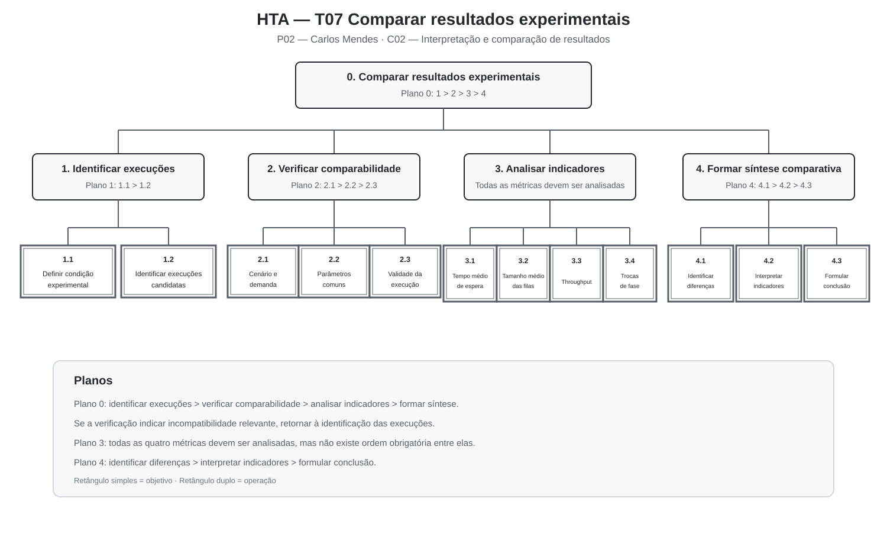
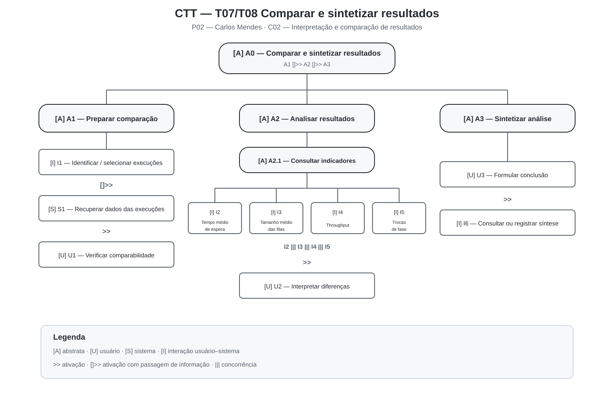

# Entrega 5 — Análise de tarefas: HTA, GOMS e CTT

**Data:** 20/10/2026  
**Status:** 🟨 em andamento  
**Responsabilidade:** cada integrante modela pelo menos 1 HTA, 1 GOMS e 1 CTT. As três técnicas podem abordar a mesma funcionalidade ou funcionalidades distintas, conforme a orientação da disciplina.

## Objetivo da atividade

Modelar tarefas importantes sob perspectivas complementares: decomposição hierárquica (HTA), estrutura de metas/métodos/operações (GOMS) e relações temporais entre tarefas (CTT). O diagrama deve ser acompanhado de interpretação textual.

## Para projetos cujo TCC não previa interface

Modele **tarefas humanas relacionadas ao uso da contribuição técnica**, e não a implementação interna do algoritmo. Exemplos de boas tarefas para análise:

- investigar uma consulta de baixo desempenho;
- configurar uma análise e selecionar parâmetros;
- submeter um dataset e verificar sua validade;
- acompanhar uma execução demorada;
- comparar dois resultados/modelos;
- interpretar uma recomendação e decidir se a aceita;
- localizar uma execução anterior usando busca/filtros;
- gerar e compartilhar um relatório;
- administrar papéis/permissões quando isso for parte do trabalho real;
- revisar um alerta e registrar uma decisão.

Um CRUD pode gerar tarefas relevantes, mas “cadastrar usuário” só merece modelagem se tiver significado no domínio (papéis, validações, riscos, permissões, dependências).

## Seleção das tarefas

| ID | Tarefa | Persona/cenário de origem | Frequência/criticidade | Autor responsável |
|---|---|---|---|---|
| {{a definir}} | {{tarefa selecionada para o HTA}} | P01 / C01 | {{a definir}} | Gabriel Koiama de Rocha Lira — 22.125.067-3 |
| {{a definir}} | {{tarefa selecionada para o GOMS}} | P01 / C01 | {{a definir}} | Gabriel Koiama de Rocha Lira — 22.125.067-3 |
| {{a definir}} | {{tarefa selecionada para o CTT}} | P01 / C01 | {{a definir}} | Gabriel Koiama de Rocha Lira — 22.125.067-3 |
| T06 | Consultar e interpretar as métricas obtidas em uma execução | P02 / C02 | Alta frequência e criticidade: as métricas fundamentam a interpretação dos resultados dos experimentos. | João Pedro Lopes Santana Villas Bôas — 22.125.065-7 |
| T07 | Comparar resultados experimentais das diferentes estratégias de controle | P02 / C02 | Alta criticidade: uma comparação inadequada pode produzir conclusões incorretas sobre o comportamento das estratégias. | João Pedro Lopes Santana Villas Bôas — 22.125.065-7 |
| T08 | Elaborar uma síntese dos resultados analisados | P02 / C02 | Alta criticidade: a síntese deve representar corretamente o conjunto das métricas e as condições experimentais consideradas. | João Pedro Lopes Santana Villas Bôas — 22.125.065-7 |

> Priorize tarefas necessárias para que o usuário alcance objetivos centrais. Não desperdice a modelagem em ações triviais isoladas, como “clicar em login”, se o objetivo relevante é maior. Da mesma forma, não modele o funcionamento interno do algoritmo como se fosse uma tarefa humana.

> Na modelagem de João, o HTA aprofunda T07, o GOMS aprofunda T06 e o CTT integra T07 e T08 para representar as relações temporais existentes entre comparação, interpretação e síntese dos resultados.

---

# Parte de Gabriel Koiama de Rocha Lira

> Esta seção será preenchida posteriormente com pelo menos um HTA, um GOMS e um CTT relacionados a P01 e C01.

## HTA — {{tarefa a definir}}

**Autor(a):** Gabriel Koiama de Rocha Lira — 22.125.067-3

### Descrição da tarefa

{{a preencher}}

### Diagrama

{{a preencher}}

### Decomposição e planos

| ID | Objetivo/operação | Plano/ordem | Problema ou decisão de design observada |
|---|---|---|---|
| 0 | {{objetivo principal}} | {{plano}} | {{...}} |

**Verificação do HTA:**

- O objetivo 0 representa uma meta do usuário?
- As subtarefas são necessárias e suficientes?
- Os **planos** indicam ordem, alternativa, repetição ou condição?
- A decomposição parou em nível útil para projeto de interação?

---

## GOMS — {{tarefa a definir}}

**Autor(a):** Gabriel Koiama de Rocha Lira — 22.125.067-3

### Goal

`G0: {{meta do usuário}}`

### Métodos, operadores e regras de seleção

{{a preencher}}

> Não chame qualquer passo de “método”. Em GOMS, métodos são sequências alternativas capazes de atingir uma meta; regras de seleção explicam quando escolher entre eles.

---

## CTT — {{tarefa a definir}}

**Autor(a):** Gabriel Koiama de Rocha Lira — 22.125.067-3

### Descrição

{{a preencher}}

### Diagrama

{{a preencher}}

### Legenda e relações temporais usadas

| Operador/relação | Significado no diagrama | Exemplo no modelo |
|---|---|---|
| {{...}} | {{...}} | {{...}} |

---

# Parte de João Pedro Lopes Santana Villas Bôas

## HTA — T07 Comparar resultados experimentais

**Autor(a):** João Pedro Lopes Santana Villas Bôas — 22.125.065-7  
**Persona/cenário de origem:** P02 — Carlos Mendes / C02 — Interpretação e comparação de resultados experimentais  
**Necessidade relacionada:** R06 — comparar o comportamento das estratégias sob condições equivalentes

### Descrição da tarefa

O objetivo da tarefa é comparar os resultados obtidos por diferentes estratégias de controle semafórico sem perder o contexto experimental associado a cada execução.

A tarefa começa quando existem duas ou mais execuções concluídas que Carlos deseja analisar. Antes de interpretar as diferenças entre as métricas, ele precisa identificar quais execuções participarão da comparação e verificar se suas condições experimentais são suficientemente equivalentes.

A comparação considera informações como cenário, condição de demanda, estratégia executada e parâmetros relevantes, além das métricas definidas no protocolo experimental: tempo médio de espera, tamanho médio das filas, throughput e número de trocas de fase.

A tarefa termina quando Carlos consegue relacionar as diferenças observadas às respectivas estratégias, interpretar o conjunto dos indicadores e formular uma conclusão coerente com as condições em que os experimentos foram realizados.

**Entrada:** execuções concluídas, condições experimentais e métricas produzidas pelas simulações.  
**Resultado esperado:** comparação tecnicamente coerente entre as estratégias, preservando a relação entre resultados e condições experimentais.

### Diagrama



*Figura 1 — HTA da tarefa T07 — Comparar resultados experimentais. Fonte: elaboração da equipe.*

### Decomposição e planos

| ID | Objetivo/operação | Plano/ordem | Problema ou decisão de design observada |
|---|---|---|---|
| 0 | **Comparar resultados experimentais sob condições equivalentes.** | **Plano 0:** realizar 1 > 2 > 3 > 4. Se em 2 as execuções não forem consideradas comparáveis, retornar a 1. | A comparação não pode separar as métricas das condições experimentais que as produziram. |
| 1 | **Identificar as execuções que serão comparadas.** | **Plano 1:** realizar 1.1 > 1.2. | O usuário precisa reconhecer claramente quais execuções participam da comparação. |
| 1.1 | Definir a condição experimental que será analisada. | Operação. | O cenário e o objetivo da comparação precisam permanecer identificáveis. |
| 1.2 | Identificar as execuções candidatas à comparação. | Operação. | Execuções semelhantes podem ser confundidas se não houver informações suficientes para distingui-las. |
| 2 | **Verificar se as execuções são comparáveis.** | **Plano 2:** realizar 2.1 > 2.2 > 2.3. Se uma condição relevante for incompatível, retornar a 1. | Comparar condições diferentes pode produzir uma conclusão incorreta sobre as estratégias. |
| 2.1 | Conferir cenário e condição de demanda. | Operação. | Cenário e demanda precisam permanecer associados a cada execução. |
| 2.2 | Conferir os parâmetros comuns relevantes. | Operação. | Diferenças de configuração não planejadas precisam ser percebidas antes da comparação. |
| 2.3 | Verificar se as execuções foram concluídas adequadamente. | Operação. | Uma execução incompleta ou inadequada pode comprometer a análise. |
| 3 | **Analisar os indicadores de desempenho.** | **Plano 3:** analisar 3.1, 3.2, 3.3 e 3.4. A ordem de consulta não é fixa, mas todos os indicadores devem ser considerados na análise completa. | As métricas representam aspectos diferentes do experimento e não devem ser interpretadas isoladamente. |
| 3.1 | Examinar o tempo médio de espera. | Operação. | O valor precisa permanecer associado à execução e à estratégia correspondentes. |
| 3.2 | Examinar o tamanho médio das filas. | Operação. | A comparação precisa deixar perceptíveis as diferenças entre as estratégias. |
| 3.3 | Examinar o throughput. | Operação. | O throughput não deve ser interpretado sem considerar os demais indicadores. |
| 3.4 | Examinar o número de trocas de fase. | Operação. | A métrica representa um aspecto diferente do comportamento do controle e deve ser interpretada em conjunto com as demais. |
| 4 | **Formar uma síntese comparativa.** | **Plano 4:** realizar 4.1 > 4.2 > 4.3. | A conclusão deve derivar do conjunto das métricas e das condições experimentais. |
| 4.1 | Identificar diferenças relevantes entre as estratégias. | Operação. | Diferenças importantes precisam ser identificadas sem reconstrução manual de todo o experimento. |
| 4.2 | Interpretar relações ou divergências entre os indicadores. | Operação. | Uma estratégia pode apresentar comportamento melhor em uma métrica e pior em outra. |
| 4.3 | Formular uma conclusão comparativa. | Operação. | A conclusão precisa manter relação com as execuções e condições que a fundamentaram. |

### Interpretação do HTA

A decomposição mostra que comparar resultados não significa apenas colocar valores lado a lado. Antes da análise das métricas existe uma etapa crítica de verificação da comparabilidade entre as execuções.

Se cenário, demanda ou parâmetros relevantes forem diferentes sem que isso faça parte do objetivo experimental, a comparação pode atribuir à estratégia de controle uma diferença provocada por outra condição.

O HTA também mostra que a interpretação depende do conjunto das métricas. Tempo médio de espera, filas, throughput e trocas de fase representam aspectos distintos do comportamento do experimento.

Por fim, o retorno previsto no Plano 0 evidencia uma ruptura importante: quando as execuções não são comparáveis, o usuário precisa revisar sua seleção antes de continuar a análise.

**Verificação do HTA:**

- O objetivo 0 representa uma meta do usuário? **Sim.**
- As subtarefas são necessárias e suficientes? **Sim, dentro do escopo definido para T07.**
- Os planos indicam ordem, alternativa, repetição ou condição? **Sim.**
- A decomposição parou em nível útil para projeto de interação? **Sim.**

---

## GOMS — T06 Consultar e interpretar métricas de uma execução

**Autor(a):** João Pedro Lopes Santana Villas Bôas — 22.125.065-7  
**Persona/cenário de origem:** P02 — Carlos Mendes / C02 — Interpretação e comparação de resultados experimentais  
**Necessidade relacionada:** R05 — compreender o desempenho obtido em cada experimento

### Goal

`G0: compreender as métricas produzidas por uma execução no contexto em que o experimento foi realizado`

### Nível adotado

O modelo utiliza operadores em nível semântico de interação e cognição, como identificar, examinar, selecionar, verificar, relacionar e interpretar informações.

Não foi aplicado GOMS-KLM nesta etapa porque ainda não existe uma interface detalhada o suficiente para estimar de maneira responsável tempos de apontamento, digitação, movimentação entre teclado e mouse ou resposta do sistema.

### Métodos, operadores e regras de seleção

**GOAL G1 — Localizar a execução que será analisada**

**Method M1 — localizar pela identificação conhecida da execução**

- **OP M1.1:** recuperar ou consultar a identificação conhecida da execução;
- **OP M1.2:** localizar a execução correspondente;
- **OP M1.3:** examinar cenário, estratégia e condição de demanda;
- **OP M1.4:** confirmar que a execução localizada corresponde ao experimento desejado.

**Method M2 — localizar pelo contexto experimental**

- **OP M2.1:** examinar as execuções disponíveis;
- **OP M2.2:** identificar o cenário e a condição de demanda de interesse;
- **OP M2.3:** identificar a estratégia de controle desejada;
- **OP M2.4:** selecionar uma execução candidata;
- **OP M2.5:** verificar se seus parâmetros e contexto correspondem ao experimento procurado.

**Selection Rule SR1:** utilizar M1 quando Carlos já conhece a identificação da execução; utilizar M2 quando conhece as características do experimento, mas não possui uma identificação exata da execução.

---

**GOAL G2 — Interpretar os indicadores da execução**

**Method M3 — analisar o conjunto principal de métricas**

- **OP M3.1:** examinar o tempo médio de espera;
- **OP M3.2:** examinar o tamanho médio das filas;
- **OP M3.3:** examinar o throughput;
- **OP M3.4:** examinar o número de trocas de fase;
- **OP M3.5:** relacionar os indicadores ao cenário e à estratégia;
- **OP M3.6:** formar uma interpretação inicial do comportamento observado.

**GOAL G2.1 — Aprofundar a análise de um indicador quando necessário**

**Method M4 — investigar uma métrica específica**

- **OP M4.1:** identificar qual indicador necessita de análise adicional;
- **OP M4.2:** examinar seu valor e seu contexto experimental;
- **OP M4.3:** relacionar o indicador às demais métricas disponíveis;
- **OP M4.4:** revisar a interpretação inicial da execução.

A meta G2.1 é executada quando determinado indicador apresenta comportamento que precisa ser compreendido com maior detalhe.

---

**GOAL G3 — Confirmar que a interpretação possui contexto suficiente**

**Method M5 — validar o contexto da interpretação**

- **OP M5.1:** verificar se cenário, demanda, estratégia e parâmetros relevantes estão identificados;
- **OP M5.2:** verificar se a execução foi concluída adequadamente;
- **OP M5.3:** decidir se as informações disponíveis são suficientes para utilizar aquele resultado;
- **OP M5.4:** retornar a G1 caso seja necessário revisar a origem da execução.

### Interpretação do GOMS

O modelo evidencia que consultar métricas não começa necessariamente pela leitura dos valores numéricos. Carlos precisa primeiro localizar corretamente a execução e compreender o contexto em que os resultados foram produzidos.

Os métodos M1 e M2 representam caminhos alternativos para atingir a mesma meta. Quando a identificação da execução é conhecida, ela pode orientar sua localização. Quando não é conhecida, o usuário precisa utilizar informações do próprio experimento, como cenário, demanda e estratégia.

Depois da localização, o usuário interpreta o conjunto dos indicadores. Caso algum resultado exija investigação adicional, a meta G2.1 permite aprofundar a análise sem substituir a interpretação geral.

Para o projeto de interação, a modelagem reforça que métricas e contexto experimental devem permanecer relacionados e que o aprofundamento em um indicador não deve fazer o usuário perder a referência da execução analisada.

> Não chame qualquer passo de “método”. Em GOMS, métodos são sequências capazes de atingir uma meta; regras de seleção explicam quando escolher entre métodos alternativos.

---

## CTT — T07/T08 Comparar e sintetizar resultados

**Autor(a):** João Pedro Lopes Santana Villas Bôas — 22.125.065-7  
**Persona/cenário de origem:** P02 — Carlos Mendes / C02 — Interpretação e comparação de resultados experimentais  
**Necessidades relacionadas:** R06 — comparar resultados; R07 — registrar e comunicar os resultados obtidos

### Descrição

O CTT representa as relações temporais existentes entre a preparação de uma comparação, a análise das métricas e a elaboração de uma síntese dos resultados.

A tarefa abstrata principal é **comparar e sintetizar resultados**. Para realizá-la, Carlos precisa primeiro identificar as execuções envolvidas e recuperar as informações necessárias para compreender seu contexto.

Após verificar se as execuções são comparáveis, as diferentes métricas podem ser consultadas sem uma ordem obrigatória entre elas. Carlos interpreta então as diferenças observadas e, somente após essa análise, formula uma conclusão e produz ou consulta a síntese correspondente.

O modelo diferencia tarefas realizadas pelo usuário, processamentos do sistema, interações usuário–sistema e tarefas abstratas utilizadas para organizar a decomposição.

### Diagrama



*Figura 2 — CTT das tarefas T07/T08 — Comparar e sintetizar resultados. Fonte: elaboração da equipe.*

### Tipos de tarefa utilizados

- **[A] Tarefa abstrata:** representa uma composição de tarefas utilizada para organizar a decomposição.
- **[U] Tarefa do usuário:** atividade realizada pelo usuário fora do processamento automático do sistema, incluindo interpretação e tomada de decisão.
- **[S] Tarefa do sistema:** processamento realizado pelo sistema sem interação do usuário naquele instante.
- **[I] Tarefa interativa:** atividade em que ocorre diálogo entre usuário e sistema.

### Estrutura do modelo

```text
[A] A0 — Comparar e sintetizar resultados
    |
    +-- [A] A1 — Preparar comparação
    |      |
    |      +-- [I] I1 — Identificar/selecionar execuções
    |      |        []>>
    |      +-- [S] S1 — Recuperar informações das execuções
    |      |        >>
    |      +-- [U] U1 — Verificar comparabilidade
    |
    +-- [A] A2 — Analisar resultados
    |      |
    |      +-- [A] A2.1 — Consultar indicadores
    |      |       |
    |      |       +-- [I] I2 — Consultar tempo médio de espera
    |      |       +-- [I] I3 — Consultar tamanho médio das filas
    |      |       +-- [I] I4 — Consultar throughput
    |      |       +-- [I] I5 — Consultar número de trocas de fase
    |      |
    |      +-- [U] U2 — Interpretar diferenças entre indicadores
    |
    +-- [A] A3 — Sintetizar análise
           |
           +-- [U] U3 — Formular conclusão
           |        >>
           +-- [I] I6 — Consultar ou registrar síntese
