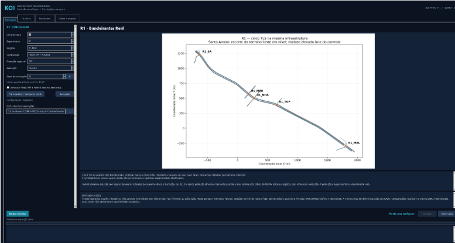
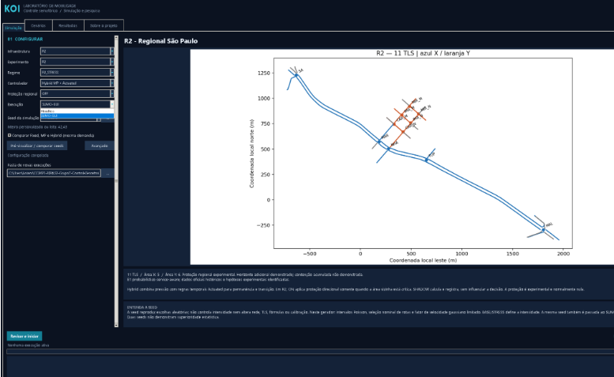
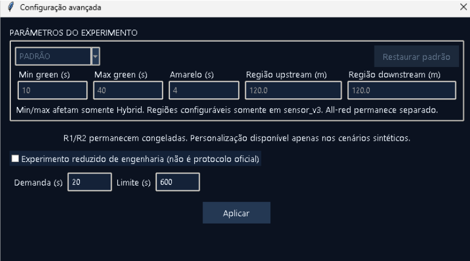
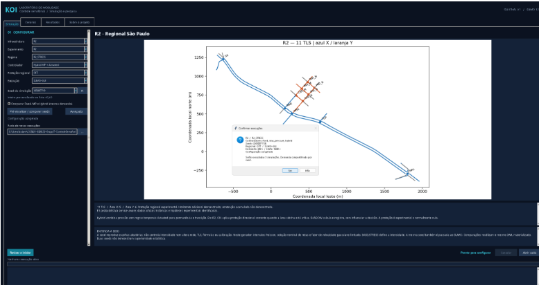
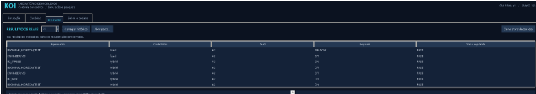
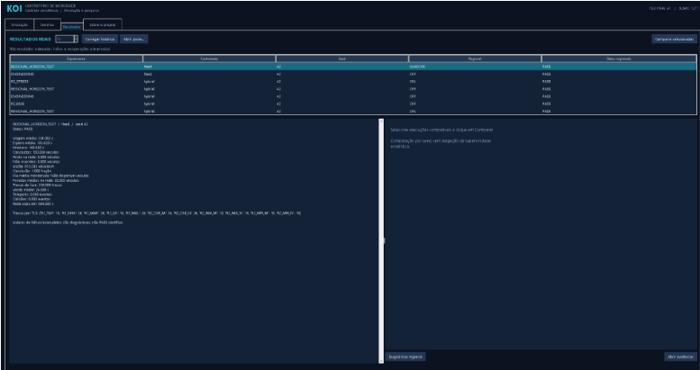
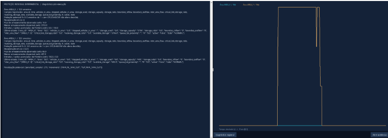

# Entrega 6 — Prototipação em papel

**Data:** 20/10/2026  
**Status:** 🟩 concluída  
**Responsabilidade:** 1 solução integrada por equipe

## Objetivo da atividade

Externalizar, organizar e avaliar ideias de interação antes de consolidar decisões de interface. O valor da atividade está no ciclo **construir → simular → observar → revisar**, e não somente no acabamento visual do protótipo.

Embora a atividade tenha como referência a prototipação em papel e de baixa fidelidade, o projeto já possuía, antes desta entrega, um **protótipo digital funcional** desenvolvido no contexto do TCC.

Conforme orientação docente, esse artefato foi utilizado como versão inicial da solução em substituição à criação artificial de uma segunda interface em papel.

O protótipo existente não é considerado uma solução definitiva. Nesta entrega, ele é tratado como uma **hipótese de design**, confrontada com as personas, cenários, necessidades e tarefas identificados nas Entregas 1–5.

A atividade foi concluída por meio de:

- documentação dos estados reais da interface;
- simulação do fluxo principal;
- walkthrough formativo;
- identificação de possíveis rupturas de interação;
- análise dos achados;
- definição de decisões de revisão para uma versão posterior.

---

# 1. Escopo do protótipo

**Personas:** P01 — Marina Ribeiro; P02 — Carlos Mendes  
**Cenários cobertos:** C01 — Preparação e execução de experimentos sob condições comparáveis; C02 — Interpretação e comparação de resultados experimentais  
**Tarefas cobertas:** T01 a T08

## Objetivos principais

- selecionar a infraestrutura ou cenário no qual o experimento será realizado;
- compreender as informações principais do cenário selecionado;
- configurar corretamente os parâmetros necessários para a simulação;
- selecionar a estratégia de controle semafórico;
- definir seed e demais condições experimentais;
- escolher entre execução Visual e Headless;
- validar a configuração antes de iniciar;
- iniciar e acompanhar a execução;
- reconhecer estados de processamento e erro;
- localizar execuções anteriores;
- consultar os resultados de uma execução;
- preservar a relação entre configuração, execução e resultado;
- utilizar as informações da interface como apoio para comparação manual entre execuções;
- interpretar e sintetizar os resultados obtidos.

---

## 1.1 Protótipo digital pré-existente — V0

A equipe já possuía uma interface desktop funcional desenvolvida no contexto do TCC **Controle Semafórico Inteligente com Max Pressure + Actuated**.

A aplicação é executada por meio do launcher `launch_gui.py` e integra a interface gráfica ao ambiente experimental baseado em Python, SUMO e TraCI.

A versão utilizada nesta atividade é denominada **V0 — protótipo digital pré-existente**.



*Figura 1 — Visão geral do protótipo digital V0, com área de configuração à esquerda, visualização da infraestrutura e informações de apoio.*

A V0 possui recursos relacionados às tarefas identificadas na disciplina, entre eles:

- catálogo de infraestruturas e cenários;
- informações sobre o cenário selecionado;
- configuração dos parâmetros experimentais;
- seleção entre Fixed-Time, Max-Pressure e Hybrid Max-Pressure + Actuated;
- configuração de seeds;
- seleção entre execução Visual/SUMO-GUI e Headless;
- configuração avançada em situações compatíveis;
- validação da configuração;
- confirmação das condições antes do início;
- início da simulação;
- feedback textual de inicialização e execução;
- execução visual por meio do SUMO-GUI;
- listagem de resultados anteriores;
- consulta individual das informações de uma execução;
- apresentação de métricas e gráficos da execução selecionada.

A V0 **não possui uma tela que compare automaticamente duas execuções**.

A comparação experimental prevista em T07 é realizada manualmente pela equipe, fora da interface, utilizando os resultados de cada execução consultados individualmente.

Essa característica é documentada explicitamente para não atribuir à interface uma funcionalidade inexistente.

---

## 1.2 Relação entre tarefas e protótipo

| Tarefa | Necessidade identificada | Como aparece na V0 |
|---|---|---|
| T01 — definir ou selecionar a malha viária | Definir onde o experimento será realizado. | Catálogo e seleção de cenário/infraestrutura. |
| T02 — configurar parâmetros do experimento | Definir corretamente as condições da simulação. | Configuração principal e configuração avançada quando aplicável. |
| T03 — selecionar estratégia de controle | Determinar claramente qual controlador será utilizado. | Seleção entre Fixed-Time, Max-Pressure e Hybrid. |
| T04 — iniciar uma simulação | Executar o experimento configurado. | Validação, confirmação das condições e comando de início. |
| T05 — verificar o estado da execução | Saber se o experimento iniciou e reconhecer seu processamento. | Feedback textual da inicialização/execução e SUMO-GUI no modo Visual. |
| T06 — consultar métricas | Compreender o desempenho obtido. | Histórico/listagem e análise da execução selecionada. |
| T07 — comparar resultados | Comparar estratégias sob condições equivalentes. | A V0 permite consultar execuções individualmente; a comparação propriamente dita é manual e externa. |
| T08 — consultar ou gerar uma síntese | Interpretar e comunicar resultados. | Informações detalhadas e gráfico da execução, utilizados como base para análise e síntese. |

---

## 1.3 Famílias de interface identificadas

| Família de interface | Utilização | Justificativa |
|---|---|---|
| Entrada/seleção de dados | Sim | Necessária para T01. |
| Configuração/parametrização | Sim | Necessária para T02 e T03. |
| Validação/confirmação | Sim | Apoia T02 e T04 antes do processamento. |
| Acompanhamento de execução | Sim | Necessário para T04 e T05. |
| Histórico/listagem | Sim | Permite recuperar execuções já produzidas. |
| Resultados | Sim | Necessário para T06 e T08. |
| Visualização gráfica | Sim | Apoia interpretação individual da execução. |
| Comparação | Parcial / externa | Os dados são fornecidos pela V0, mas a comparação entre execuções é feita manualmente fora dela. |
| Auditoria/logs | Secundário | Existem informações técnicas de execução, mas não são o objetivo principal das personas. |
| Administração | Não | Não existe tarefa que justifique administração de usuários/permissões. |
| CRUD genérico | Não | Não existe necessidade identificada que justifique esse padrão. |

---

# 2. Fluxos escolhidos

| Fluxo | Tarefas | Objetivo |
|---|---|---|
| PF01 — Preparar experimento | T01, T02 e T03 | Escolher cenário e definir condições experimentais. |
| PF02 — Validar, executar e acompanhar | T04 e T05 | Conferir as condições, iniciar a simulação e reconhecer seu processamento. |
| PF03 — Localizar e analisar resultados | T06, T07 e T08 | Recuperar execuções, analisar resultados e fornecer base para comparação manual. |

---

## 2.1 PF01 — Preparar experimento

```text
Selecionar cenário
        |
        v
Consultar informações do cenário
        |
        v
Configurar parâmetros
        |
        v
Selecionar controlador
        |
        v
Definir seed
        |
        v
Selecionar modo Visual ou Headless
        |
        v
Acessar configuração avançada, se necessário
        |
        v
Revisar configuração
```

---

## 2.2 PF02 — Validar, executar e acompanhar

```text
Configuração preparada
        |
        v
Solicitar execução
        |
        v
Validar configuração
        |
        +------ inconsistente ------> informar erro
        |                                  |
        |                                  v
        |                           corrigir configuração
        |
        v
Apresentar resumo das condições
        |
        v
Confirmar execução
        |
        v
Inicializar processamento
        |
        v
Exibir feedback
        |
        +------ modo Visual ------> SUMO-GUI
        |
        v
Execução concluída
```

---

## 2.3 PF03 — Localizar, analisar e apoiar comparação

```text
Execução concluída
        |
        v
Abrir listagem de resultados
        |
        v
Selecionar execução
        |
        v
Consultar contexto e métricas
        |
        v
Consultar gráfico/diagnóstico
        |
        +------ deseja comparar? ------+
        |                              |
        | sim                          | não
        v                              v
Voltar à listagem                 Formar síntese
        |
        v
Selecionar outra execução
        |
        v
Consultar seus resultados
        |
        v
Comparar manualmente fora da interface
        |
        v
Formar síntese
```

---

# 3. Telas, estados e evidências visuais

As capturas foram obtidas em diferentes momentos de utilização da V0.

Elas representam **estados reais da interface**, mas não necessariamente uma única execução contínua.

---

## PP01 — Catálogo e seleção do cenário

**Fluxo:** PF01  
**Tarefa:** T01  
**Persona principal:** P01


*Figura 2 — Catálogo de infraestruturas e visualização do cenário selecionado.*

### Função observada

A interface permite selecionar uma infraestrutura a partir de um catálogo e visualizar informações gráficas e textuais relacionadas ao cenário.

### Aspecto positivo

A representação gráfica oferece mais contexto do que a utilização isolada de identificadores técnicos.

### Possível dificuldade

A presença simultânea de códigos técnicos e informações de domínio pode exigir conhecimento prévio do usuário.

---

# PP02 — Configuração da simulação

**Fluxo:** PF01  
**Tarefas:** T02 e T03  
**Persona principal:** P01

## Configuração principal e controlador


*Figura 3 — Configuração do experimento e seleção do controlador.*

## Modo de execução



*Figura 4 — Seleção entre modos de execução disponíveis.*

## Configuração avançada



*Figura 5 — Parâmetros avançados do experimento.*

### Função observada

A configuração está dividida entre parâmetros principais e opções avançadas.

### Aspectos positivos

- permite selecionar controlador;
- mantém condições experimentais explícitas;
- permite escolher Visual/SUMO-GUI ou Headless;
- parâmetros menos frequentes permanecem separados da área principal.

### Possíveis dificuldades

- parte dos rótulos exige conhecimento técnico;
- Visual/Headless pode não ser imediatamente compreensível sem experiência prévia;
- a configuração avançada possui alta densidade de parâmetros.

---

# PP03 — Validação e confirmação pré-execução

**Fluxo:** PF01/PF02  
**Tarefas:** T02 e T04  
**Persona principal:** P01

## Validação de condição inadequada


*Figura 6 — Mensagem apresentada diante de condição que impede a continuidade.*

## Confirmação antes da execução



*Figura 7 — Resumo e confirmação apresentados antes do início do processamento.*

### Função observada

A V0 possui dois mecanismos complementares:

1. bloqueio quando uma condição não é aceita;
2. confirmação das condições antes da execução válida.

### Aspecto positivo

O sistema reduz o risco de iniciar acidentalmente um experimento diferente do pretendido.

### Possível dificuldade

Mensagens muito técnicas podem informar o problema sem necessariamente orientar claramente como corrigi-lo.

---

# PP04 — Inicialização e feedback da execução

**Fluxo:** PF02  
**Tarefas:** T04 e T05  
**Persona principal:** P01


*Figura 8 — Feedback textual apresentado durante a inicialização.*

### Função observada

A V0 comunica informações como:

- estágio da execução;
- controlador;
- seed;
- inicialização do SUMO;
- mensagens relacionadas ao processamento.

### Aspecto positivo

Existe feedback de que a solicitação foi reconhecida.

### Possível dificuldade

Parte da informação aparece em formato próximo a log técnico, incluindo identificadores e mensagens internas.

---

# PP05 — Execução no modo Visual

**Fluxo:** PF02  
**Tarefa:** T05  
**Persona principal:** P01


*Figura 9 — Simulação em execução no SUMO-GUI.*

### Função observada

Quando o modo Visual é selecionado, a simulação pode ser inspecionada diretamente no SUMO-GUI.

### Aspecto positivo

A representação espacial oferece uma forma direta de observar o comportamento da rede.

### Possível dificuldade

A execução ocorre em uma janela externa, criando uma separação visual entre a V0 e a simulação.

---

# PP06 — Histórico e seleção de execução

**Fluxo:** PF03  
**Tarefas:** T06 e T07  
**Personas:** P01 e P02



*Figura 10 — Listagem das execuções/resultados disponíveis.*

### Função observada

A interface permite localizar uma execução anterior a partir da listagem e de informações associadas.

### Aspecto positivo

A análise mantém relação com informações como controlador, seed e demais identificadores do experimento.

### Possível dificuldade

Com grande quantidade de execuções, a recuperação pode se tornar mais trabalhosa.

Isso não implica automaticamente a necessidade de filtros; essa questão deve ser investigada posteriormente.

---

# PP07 — Análise individual dos resultados

**Fluxo:** PF03  
**Tarefas:** T06, T07 e T08  
**Personas:** P01 e P02

## Informações da execução



*Figura 11 — Resultado detalhado da execução selecionada.*

## Gráfico/diagnóstico



*Figura 12 — Representação gráfica relacionada à execução selecionada.*

### Função observada

A V0 permite examinar uma execução individualmente utilizando informações textuais e representação gráfica.

### Aspectos positivos

- resultado permanece ligado a uma execução identificável;
- existe acesso a informações detalhadas;
- há apoio gráfico à análise.

### Limitação observada

Não existe comparação automática entre duas execuções.

Para T07:

```text
consultar execução A
        ↓
registrar/interpretar A
        ↓
consultar execução B
        ↓
registrar/interpretar B
        ↓
comparar A e B externamente
```

---

# 3.1 Navegação consolidada

```text
PP01
Cenário
   |
   v
PP02
Configuração
   |
   v
PP03
Validação/confirmação
   |
   v
PP04
Inicialização
   |
   +------ Visual ------> PP05
   |
   v
PP06
Histórico/seleção
   |
   v
PP07
Análise individual
   |
   +------ outra execução ------> PP06
   |
   v
Comparação manual externa
   |
   v
Síntese
```

---

# 4. Walkthrough formativo

## 4.1 Participante avaliador

O avaliador não participou da implementação da interface e recebeu como base:

- contexto geral do projeto;
- tarefas que deveriam ser realizadas;
- estados reais da V0;
- doze capturas de tela da aplicação.

O objetivo foi verificar se, a partir das informações apresentadas, seria possível:

- compreender o caminho principal;
- identificar ações;
- perceber feedback;
- interpretar resultados;
- identificar possíveis rupturas de interação.

---

# 4.2 W01 — Preparar experimento

### Tarefa apresentada

> Prepare uma simulação escolhendo um cenário, controlador, seed e modo de execução.

### Caminho identificado pelo avaliador

```text
Cenários
→ selecionar infraestrutura
→ Configuração
→ definir condições
→ escolher controlador
→ escolher modo
→ revisar
```

### Observações

O avaliador conseguiu reconhecer a separação entre cenário e configuração.

A escolha do controlador foi identificada corretamente.

Entretanto, alguns termos foram interpretados como dependentes de conhecimento técnico prévio, especialmente:

- Fixed;
- Max-Pressure;
- Hybrid;
- Headless;
- parâmetros avançados.

### Resultado

**Tarefa compreendida, com possível necessidade de ajuda contextual em termos técnicos.**

---

# 4.3 W02 — Validar e iniciar

### Tarefa apresentada

> Inicie o experimento e identifique o que ocorre caso a configuração seja inadequada.

### Caminho identificado

```text
configuração
→ iniciar
→ validação
→ corrigir, caso exista erro
→ confirmar
→ executar
```

### Observações

O avaliador reconheceu facilmente que a mensagem de erro bloqueia o prosseguimento.

A confirmação apresentada antes da execução foi interpretada como mecanismo positivo para evitar execução acidental.

O principal ponto levantado foi que mensagens de erro devem, além de informar o problema, explicar qual ação permite corrigi-lo.

### Resultado

**Tarefa compreendida e mecanismo de prevenção de erro considerado positivo.**

---

# 4.4 W03 — Acompanhar a execução

### Tarefa apresentada

> Determine como identificar que a simulação realmente começou e está sendo processada.

### Caminho identificado

```text
confirmação
→ inicialização
→ feedback textual
→ SUMO-GUI no modo Visual
```

### Observações

O avaliador identificou que a aplicação fornece feedback textual durante a inicialização.

No modo Visual, a abertura do SUMO-GUI fornece evidência forte de que a simulação está ativa.

Entretanto, o texto de processamento foi percebido como próximo de um log técnico.

### Resultado

**O início da execução é identificável, mas o estado principal poderia ser destacado de forma mais simples.**

---

# 4.5 W04 — Consultar e comparar resultados

### Tarefa apresentada

> Localize uma execução anterior, consulte seus resultados e determine como compará-la com outra execução.

### Caminho identificado

```text
Resultados
→ selecionar execução A
→ consultar resultados
→ voltar
→ selecionar execução B
→ consultar resultados
→ comparar externamente
```

### Observações

O avaliador identificou corretamente a listagem de resultados e a relação entre execução selecionada e informações exibidas.

Também identificou que a interface fornece análise detalhada e gráfico de uma execução por vez.

Ao tentar realizar a comparação, ficou evidente que não existe uma visualização lado a lado ou um comparador automático.

### Resultado

**Consulta individual compreendida. Comparação possível apenas mediante trabalho manual externo.**

---

# 4.6 Registro consolidado das observações

| ID | Tela/ação | Observação do avaliador | Consequência para o design |
|---|---|---|---|
| O01 | PP01/PP02 | Separação entre cenário e configuração é compreensível. | Manter organização geral. |
| O02 | PP02 | Termos técnicos podem exigir conhecimento prévio. | Considerar ajuda contextual e descrições curtas. |
| O03 | PP02 | Configuração avançada apresenta grande quantidade de parâmetros. | Manter parâmetros avançados separados do fluxo principal. |
| O04 | PP03 | Validação antes de iniciar foi considerada clara e útil. | Preservar mecanismo. |
| O05 | PP03 | Mensagens de erro devem facilitar também a recuperação. | Relacionar problema, causa e ação recomendada. |
| O06 | PP04 | Há feedback de processamento, mas parte dele se parece com log técnico. | Destacar estado principal em linguagem direta. |
| O07 | PP05 | SUMO-GUI deixa a execução visualmente evidente. | Preservar modo Visual. |
| O08 | PP06 | Histórico permite localizar execuções. | Preservar contexto associado a cada execução. |
| O09 | PP07 | Resultado individual possui informação e gráfico suficientes para análise. | Preservar vínculo entre resultado e execução. |
| O10 | PP06/PP07 | Comparação exige alternância entre execuções e trabalho externo. | Considerar apoio à comparação em versão futura. |

---

# 5. Alterações e decisões V0 → V1

O walkthrough gerou decisões de revisão para uma **V1 conceitual**.

Essas mudanças representam a próxima direção de design e não significam que o código da V0 já tenha sido modificado.

| Antes — V0 | Problema observado | Depois — V1 proposta | Justificativa |
|---|---|---|---|
| Termos técnicos apresentados diretamente. | Podem exigir experiência prévia. | Ajuda contextual ou descrição curta junto aos termos principais. | Melhorar compreensão sem remover precisão técnica. |
| Configuração avançada com muitos parâmetros. | Possível sobrecarga de informação. | Manter configuração principal separada da avançada. | Preservar simplicidade do fluxo principal. |
| Mensagens de erro predominantemente informativas. | Usuário pode saber que há erro, mas não como corrigir. | Informar problema, elemento relacionado e ação recomendada. | Melhorar recuperação de erro. |
| Feedback de processamento semelhante a log. | Estado principal compete com detalhes técnicos. | Exibir estado direto: aguardando, executando, concluído ou erro; manter logs como detalhe. | Melhorar visibilidade do sistema. |
| Resultados possuem muitos detalhes simultâneos. | Métricas prioritárias podem perder destaque. | Criar hierarquia entre síntese e detalhes. | Facilitar interpretação. |
| Comparação realizada externamente. | Exige alternar, memorizar ou transportar dados. | Investigar visualização comparativa lado a lado. | Reduzir carga cognitiva em T07. |

---

# 6. Limitações da V0 identificadas

O walkthrough evidenciou as seguintes limitações:

- não existe comparação automática entre duas execuções;
- a comparação exige alternância entre resultados e trabalho externo;
- alguns termos pressupõem conhecimento técnico;
- feedback de processamento utiliza informações próximas a logs;
- configurações avançadas possuem elevada densidade de parâmetros;
- diferentes perfis de usuário podem necessitar níveis distintos de detalhamento.

Essas limitações serão consideradas nas entregas posteriores.

---

# 7. Decisões consolidadas

## 7.1 Preservar contexto experimental

Cenário, controlador, seed e parâmetros devem permanecer associados ao resultado.

## 7.2 Manter validação pré-execução

A prevenção de erro existente na V0 foi considerada adequada e deve ser preservada.

## 7.3 Melhorar recuperação diante de erro

Mensagens devem comunicar:

```text
o que ocorreu
+
onde ocorreu
+
como corrigir
```

## 7.4 Destacar estado principal

O usuário não deve depender exclusivamente de logs para compreender a execução.

## 7.5 Manter configurações avançadas sob demanda

Parâmetros especializados devem permanecer disponíveis sem dominar o fluxo principal.

## 7.6 Investigar apoio à comparação

A comparação automática não existe na V0, mas o walkthrough mostrou que ela pode reduzir esforço relacionado a T07.

Essa possibilidade será explorada nas etapas posteriores sem ser tratada como requisito definitivamente validado.

---

# 8. Relação com as entregas anteriores

### Entrega 1

Definiu o pesquisador/analista de mobilidade como usuário prioritário e estruturou configuração, execução e análise.

### Entrega 2

Forneceu referências de ferramentas profissionais.

### Entrega 3

Formalizou P01 e P02 e a jornada experimental.

### Entrega 4

Aprofundou C01 e C02.

### Entrega 5

Detalhou T02–T08 por HTA, GOMS e CTT.

### Entrega 6

Materializa as tarefas na V0, documenta seus estados reais, realiza walkthrough formativo e registra revisões V0→V1.

---

# 9. Evidências visuais

Os arquivos da entrega são:

| Arquivo | Evidência |
|---|---|
| `visao_geral_v0.png` | Visão geral da V0. |
| `pp01_catalogo.png` | Catálogo e seleção de cenário. |
| `pp02_configuracao.png` | Configuração principal/controlador. |
| `pp02_modo_execucao.png` | Seleção Visual/Headless. |
| `pp02_configuracao_avancada.png` | Configuração avançada. |
| `pp03_validacao.png` | Validação/erro. |
| `pp03_confirmacao.png` | Confirmação pré-execução. |
| `pp04_execucao.png` | Inicialização e feedback. |
| `pp05_sumo_visual.png` | Simulação no SUMO-GUI. |
| `pp06_historico.png` | Histórico/listagem de execuções. |
| `pp07_resultados.png` | Resultado individual. |
| `pp07_grafico.png` | Gráfico/diagnóstico individual. |

Todos devem ser armazenados em:

```text
assets/06_prototipos/
```

---

# 10. Estado da atividade

A Entrega 6 está concluída.

Foram produzidos e documentados:

- escopo do protótipo;
- relação com T01–T08;
- três fluxos principais;
- estados PP01–PP07;
- doze evidências visuais;
- dez observações de interação;
- seis decisões de revisão V0→V1;
- limitações da V0;
- correção da documentação sobre comparação manual.

---

# Checklist

- [x] O protótipo cobre tarefas relevantes da Entrega 5.
- [x] Cada estado visual pode ser justificado por tarefa ou necessidade.
- [x] O projeto não adicionou funcionalidades apenas para parecer completo.
- [x] Telas/estados estão documentados.
- [x] As evidências visuais da V0 foram registradas.
- [x] Foi realizado walkthrough formativo.
- [x] O walkthrough gerou observações e decisões de revisão.
- [x] A documentação foi corrigida para representar a comparação como manual e externa.
- [x] Existe proposta explícita V0→V1.
- [x] A forma de realização do walkthrough foi documentada.
- [x] O protótipo foi tratado como artefato formativo e não como solução automaticamente validada.

---

# Referências

- BARBOSA, Simone D. J.; SILVA, Bruno S. **Interação Humano-Computador**. Elsevier/Campus, 2010.
- CENTRO UNIVERSITÁRIO FEI. **CC8122 — Interação Humano-Computador: materiais de aula sobre processos de projeto, prototipação e avaliação formativa**. 2026/2.
- Projeto de TCC — **Controle Semafórico Inteligente com Max Pressure + Actuated**, plataforma experimental em Python, SUMO e TraCI.
- `Relatorio_GUI_FINAL.md` — documentação da interface desktop consolidada.
- `LEIA_PRIMEIRO_R3.txt` — instruções de execução e extensão da plataforma.
