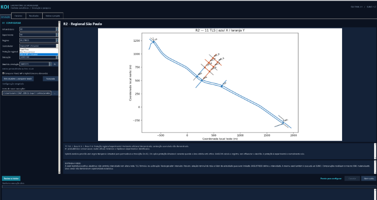
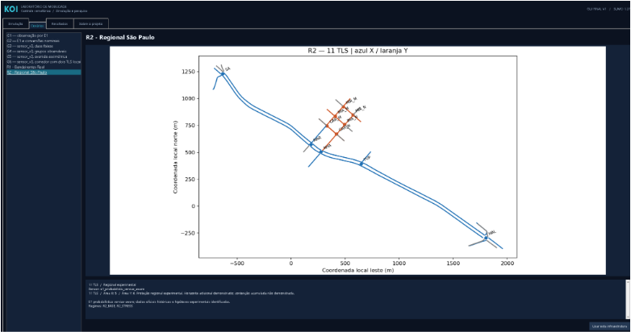
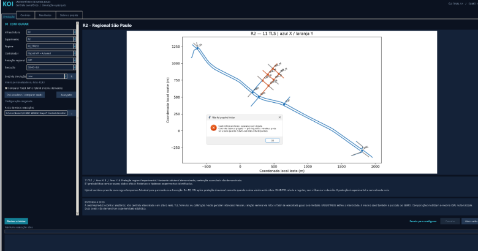
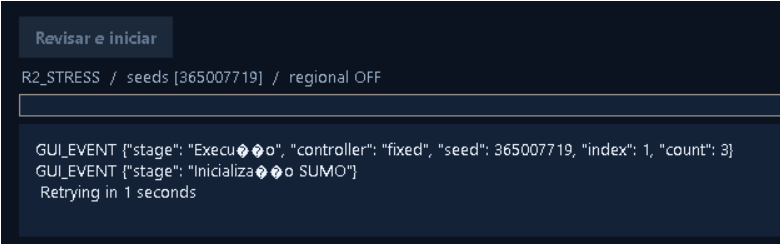
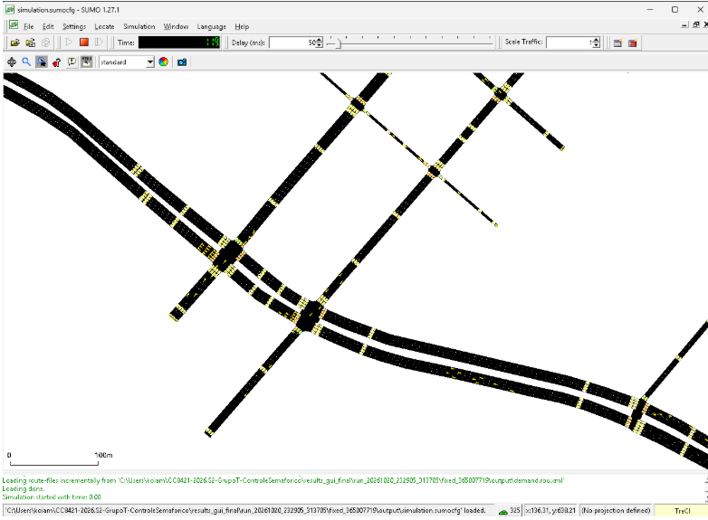

# Entrega 6 — Prototipação em papel

**Data:** 20/10/2026  
**Status:** 🟨 em andamento  
**Responsabilidade:** 1 solução integrada por equipe

## Objetivo da atividade

Externalizar e avaliar rapidamente ideias de interação antes de consolidar decisões de interface. O valor da atividade está no ciclo **construir → simular → observar → revisar**, e não somente no acabamento visual do protótipo.

Embora a atividade tenha como referência a prototipação em papel e de baixa fidelidade, o projeto já possuía, antes desta entrega, um **protótipo digital funcional** desenvolvido no contexto do TCC.

Conforme orientação docente, esse artefato foi utilizado como versão inicial da solução em substituição à criação artificial de uma segunda interface em papel.

O protótipo existente não é considerado uma solução definitiva. Nesta entrega, ele é tratado como uma **hipótese de design**, confrontada com as personas, cenários, necessidades e tarefas identificadas nas Entregas 1–5.

---

## 1. Escopo do protótipo

**Personas:** P01 — Marina Ribeiro; P02 — Carlos Mendes  
**Cenários cobertos:** C01 — Preparação e execução de experimentos sob condições comparáveis; C02 — Interpretação e comparação de resultados experimentais  
**Tarefas cobertas:** T01 a T08

### Objetivos principais

- selecionar a infraestrutura ou cenário no qual o experimento será realizado;
- compreender as informações principais do cenário selecionado;
- configurar corretamente os parâmetros necessários para a simulação;
- selecionar a estratégia de controle semafórico;
- definir seed e demais condições experimentais;
- escolher entre execução Visual e Headless;
- iniciar e acompanhar a execução;
- reconhecer estados de processamento, conclusão e erro;
- consultar as métricas produzidas;
- preservar a relação entre configuração, execução e resultado;
- recuperar execuções anteriores quando necessário;
- comparar execuções realizadas sob condições equivalentes;
- interpretar e sintetizar os resultados obtidos.

### 1.1 Protótipo digital pré-existente — V0

A equipe já possuía uma interface desktop funcional desenvolvida no contexto do TCC **Controle Semafórico Inteligente com Max Pressure + Actuated**.

A aplicação é executada por meio do launcher `launch_gui.py` e integra a interface gráfica ao ambiente experimental baseado em Python, SUMO e TraCI.

A versão utilizada nesta atividade é denominada **V0 — protótipo digital pré-existente**.

A V0 já possui recursos relacionados às tarefas identificadas na disciplina, entre eles:

- catálogo de infraestruturas e cenários;
- informações sobre o cenário selecionado;
- configuração dos parâmetros experimentais;
- seleção entre Fixed-Time, Max-Pressure e Hybrid Max-Pressure + Actuated;
- configuração de seeds;
- execução em modo Visual ou Headless;
- configuração do delay da visualização;
- início da simulação;
- feedback de execução e progresso;
- cancelamento da execução;
- apresentação das métricas produzidas;
- acesso à pasta de resultados;
- consulta de resultados anteriores;
- comparação entre execuções compatíveis;
- validações e estados desabilitados para condições incompatíveis.

A utilização do protótipo funcional nesta entrega permite avaliar a estrutura de interação já existente sem confundir o fato de o sistema funcionar tecnicamente com a conclusão de que sua interface já esteja adequada aos usuários.

---

## 1.2 Relação entre tarefas e protótipo

| Tarefa | Necessidade identificada | Como aparece na V0 |
|---|---|---|
| T01 — definir ou selecionar a malha viária | Definir onde o experimento será realizado. | Catálogo e seleção de cenário/infraestrutura. |
| T02 — configurar parâmetros do experimento | Definir corretamente as condições da simulação. | Área de configuração e parametrização. |
| T03 — selecionar estratégia de controle | Determinar claramente qual controlador será utilizado. | Seleção entre Fixed-Time, Max-Pressure e Hybrid. |
| T04 — iniciar uma simulação | Executar o experimento configurado. | Controle de início da execução. |
| T05 — verificar o estado da execução | Saber se o experimento está aguardando, executando, concluído ou com problema. | Estado/progresso da execução, feedback e cancelamento. |
| T06 — consultar métricas | Compreender o desempenho obtido. | Painel de resultados e métricas com unidades. |
| T07 — comparar resultados | Comparar estratégias sob condições equivalentes. | Seleção e comparação de execuções compatíveis. |
| T08 — consultar ou gerar uma síntese | Interpretar e comunicar os resultados. | Resultados consolidados, gráficos e informações da execução. |

---

## 1.3 Possíveis famílias de interface

Foram consideradas somente famílias justificadas pelas tarefas já identificadas.

| Família de interface | Utilização | Justificativa |
|---|---|---|
| Entrada/seleção de dados | Sim | Necessária para T01 e para a definição da condição experimental. |
| Configuração/parametrização | Sim | Necessária para T02 e T03. |
| Acompanhamento de execução | Sim | Necessário para T04 e T05. |
| Relatório/resultados | Sim | Necessário para T06 e T08. |
| Comparação | Sim | Necessária para T07. |
| Histórico | Parcial | Apoia a recuperação de execuções já existentes para análise e comparação. |
| Dashboard | Parcial | A V0 já organiza métricas e visualizações, mas não foi criado um novo dashboard apenas para a atividade. |
| Auditoria/logs | Secundário | Existe suporte técnico, porém não constitui o objetivo principal das personas priorizadas. |
| Administração | Não | Não existe tarefa identificada nas Entregas 1–5 que justifique administração de usuários ou permissões. |
| CRUD genérico | Não | Não contribui diretamente para os objetivos centrais dos usuários definidos. |

> O objetivo desta entrega não é adicionar funcionalidades para que o sistema pareça mais completo, mas verificar se a interação necessária para as tarefas centrais está adequadamente representada.

---

## 2. Fluxos escolhidos

| Fluxo | Tarefa/objetivo | Por que foi priorizado |
|---|---|---|
| PF01 — Preparar experimento | T01, T02 e T03 | Representa a preparação necessária antes de qualquer execução e concentra decisões críticas sobre cenário, parâmetros e estratégia. |
| PF02 — Executar e acompanhar simulação | T04 e T05 | Permite verificar se o usuário entende como iniciar o experimento e reconhecer seu estado durante o processamento. |
| PF03 — Analisar e comparar resultados | T06, T07 e T08 | Representa a finalidade analítica da plataforma: compreender resultados e comparar diferentes estratégias sob condições adequadas. |

### 2.1 PF01 — Preparar experimento

```text
Selecionar cenário
        |
        v
Consultar informações do cenário
        |
        v
Configurar parâmetros
        |
        v
Selecionar controlador
        |
        v
Definir seed
        |
        v
Selecionar modo Visual ou Headless
        |
        v
Revisar configuração
```

Esse fluxo corresponde principalmente ao cenário C01.

A preparação é crítica porque uma configuração incorreta pode produzir uma execução tecnicamente válida, mas inadequada para o objetivo experimental ou para uma comparação posterior.

---

### 2.2 PF02 — Executar e acompanhar

```text
Configuração preparada
        |
        v
Solicitar execução
        |
        v
Validar configuração
        |
        +------ inconsistência ------> revisar configuração
        |
        v
Iniciar simulação
        |
        v
Acompanhar estado/progresso
        |
        +------ cancelar, se necessário
        |
        v
Concluir execução
        |
        v
Apresentar resultado ou erro
```

Esse fluxo deriva diretamente das tarefas T04 e T05 e do CTT produzido na Entrega 5.

A interface deve permitir que o usuário reconheça que o sistema continua trabalhando durante uma execução demorada e diferencie corretamente estados de execução, conclusão, cancelamento e erro.

---

### 2.3 PF03 — Analisar e comparar

```text
Execução concluída
        |
        v
Consultar identificação da execução
        |
        v
Consultar métricas
        |
        v
Recuperar outra execução
        |
        v
Verificar compatibilidade
        |
        +------ incompatível ------> selecionar outra execução
        |
        v
Comparar resultados
        |
        v
Interpretar diferenças
        |
        v
Formar síntese
```

Esse fluxo corresponde principalmente ao cenário C02.

A comparação não deve apresentar valores isolados sem preservar informações suficientes sobre cenário, controlador, seed, parâmetros e demais condições relevantes.

---

## 3. Telas e estados

Para não conflitar com os identificadores `P01` e `P02` já utilizados para personas, os estados do protótipo desta entrega utilizam o prefixo `PP`.

---

### PP01 — Catálogo e seleção do cenário

**Fluxo:** PF01  
**Tarefa relacionada:** T01  
**Persona principal:** P01 — Marina Ribeiro

**Objetivo:** permitir que o usuário reconheça as infraestruturas disponíveis e selecione o cenário que pretende utilizar.

Esse estado deve apresentar contexto suficiente para diferenciar os cenários disponíveis e evitar que a seleção dependa apenas de identificadores técnicos.



*Figura 1 — Catálogo e seleção do cenário no protótipo digital V0.*

---

### PP02 — Configuração da simulação

**Fluxo:** PF01  
**Tarefas relacionadas:** T02 e T03  
**Persona principal:** P01 — Marina Ribeiro

**Objetivo:** permitir que o usuário configure as condições experimentais e reconheça claramente qual estratégia será utilizada.

Entre as informações relevantes estão:

- cenário selecionado;
- controlador;
- seed;
- modo de execução;
- parâmetros aplicáveis;
- condições experimentais relevantes.



*Figura 2 — Configuração da simulação no protótipo digital V0.*

---

### PP03 — Validação e prevenção de erro

**Fluxo:** PF01/PF02  
**Tarefas relacionadas:** T02 e T04  
**Persona principal:** P01 — Marina Ribeiro

**Objetivo:** impedir ou sinalizar uma condição inadequada antes que ela seja tratada como execução válida.

Esse estado materializa uma necessidade identificada na análise de tarefas: problemas de configuração devem ser percebidos antes da execução sempre que possível.

Podem ser utilizados como evidência:

- seed inválida;
- campo obrigatório incorreto;
- valor incompatível;
- combinação de opções não suportada;
- controle corretamente desabilitado.



*Figura 3 — Estado de validação ou prevenção de uma configuração inadequada.*

---

### PP04 — Execução em andamento

**Fluxo:** PF02  
**Tarefas relacionadas:** T04 e T05  
**Persona principal:** P01 — Marina Ribeiro

**Objetivo:** permitir que o usuário perceba que a simulação foi iniciada e acompanhe seu estado.

Durante uma execução, a interface deve fornecer feedback suficiente para evitar a impressão de travamento.

Elementos relevantes podem incluir:

- estado atual;
- progresso;
- informações da execução;
- opção de cancelamento;
- indicação da simulação ativa.



*Figura 4 — Interface principal durante uma simulação em andamento.*

---

### PP05 — Execução no modo Visual

**Fluxo:** PF02  
**Tarefa relacionada:** T05  
**Persona principal:** P01 — Marina Ribeiro

**Objetivo:** permitir a inspeção visual da simulação quando o usuário seleciona o modo Visual.

Nesse modo, o SUMO-GUI apresenta a movimentação dos veículos e o comportamento dos semáforos durante o experimento.



*Figura 5 — Execução de uma simulação no SUMO-GUI.*

O modo Visual é utilizado para inspeção e demonstração. Mantidas as mesmas condições experimentais, a escolha entre Visual e Headless não deve representar uma alteração do controlador ou da lógica científica utilizada no experimento.

---

### PP06 — Resultados da execução

**Fluxo:** PF03  
**Tarefas relacionadas:** T06 e T08  
**Personas:** P01 — Marina Ribeiro; P02 — Carlos Mendes

**Objetivo:** apresentar os resultados produzidos sem perder sua associação com a execução que os originou.

A V0 pode apresentar, quando disponíveis, informações como:

- cenário;
- controlador;
- seed;
- metodologia;
- tempo médio de viagem;
- tempo médio de espera;
- timeLoss;
- fila média;
- fila máxima;
- throughput;
- completion;
- veículos inacabados;
- veículos não inseridos;
- trocas de fase;
- duração dos verdes;
- caminho completo dos resultados.


*Figura 6 — Consulta das métricas de uma execução concluída.*

A interface deve utilizar os resultados realmente produzidos pela plataforma experimental. Métricas ausentes não devem ser substituídas por valores fictícios.

---

### PP07 — Comparação de execuções

**Fluxo:** PF03  
**Tarefas relacionadas:** T07 e T08  
**Persona principal:** P02 — Carlos Mendes

**Objetivo:** comparar resultados de diferentes estratégias preservando as condições que tornam a comparação adequada.

A comparação deve manter identificáveis elementos como:

- cenário;
- controlador;
- seed;
- horizonte;
- demanda;
- metodologia;
- parâmetros relevantes;
- métricas analisadas.


*Figura 7 — Comparação de resultados no protótipo digital V0.*

Execuções incompatíveis não devem ser apresentadas silenciosamente como equivalentes.

---

## 3.1 Navegação entre os estados principais

```text
PP01
Catálogo/cenário
   |
   v
PP02
Configuração
   |
   +------ condição inválida ------> PP03
   |                                Validação
   |                                   |
   |                                   +----> PP02
   |
   v
PP04
Execução
   |
   +------ modo Visual -----------> PP05
   |
   v
PP06
Resultados
   |
   v
PP07
Comparação
```

A navegação representa o fluxo central identificado no projeto:

**definição da malha viária → configuração da simulação e da estratégia → execução e acompanhamento → análise e comparação dos resultados.**

---

## 3.2 Estados e controles relevantes

| Estado | Controle/ação principal | Mudança produzida |
|---|---|---|
| PP01 | Selecionar cenário | Atualiza cenário e informações disponíveis para a configuração. |
| PP02 | Alterar controlador | Define a estratégia utilizada na execução. |
| PP02 | Definir seed | Define uma condição necessária à reprodução e comparação do experimento. |
| PP02 | Selecionar Visual/Headless | Define a forma de execução e acompanhamento. |
| PP02 | Executar | Solicita validação e início da simulação. |
| PP03 | Corrigir configuração | Retorna o fluxo a uma condição válida. |
| PP04 | Cancelar | Interrompe a execução quando suportado. |
| PP04 | Acompanhar | Permite reconhecer o progresso e estado da simulação. |
| PP05 | Inspecionar SUMO-GUI | Permite observar visualmente a execução. |
| PP06 | Abrir resultados | Permite consultar informações completas associadas à execução. |
| PP07 | Selecionar execuções | Define quais resultados participarão da comparação. |

---

## 4. Simulação / walkthrough

A V0 deve ser submetida a uma avaliação formativa com uma pessoa que **não participou da elaboração da interface**.

O objetivo não é medir desempenho estatístico nem substituir a avaliação final da Entrega 14. Nesta etapa, pretende-se identificar problemas de compreensão, navegação, feedback, prevenção de erro e organização do fluxo.

### 4.1 Participante

O participante deve:

- não ter participado da elaboração das telas;
- receber apenas o objetivo da tarefa;
- não receber instruções antecipadas sobre qual botão ou caminho utilizar.

A identidade do participante não precisa ser registrada publicamente se não for necessária para a atividade.

---

## 4.2 Cenário adotado

Para reduzir interferências causadas pela complexidade científica das infraestruturas mais recentes, o walkthrough deve priorizar um cenário consolidado, como **G1**.

O objetivo da sessão é avaliar a interação, e não validar a superioridade de um controlador nem realizar uma nova bateria científica.

---

## 4.3 Tarefas do walkthrough

### W01 — Preparar um experimento

> Você precisa preparar uma simulação utilizando o cenário G1, o controlador Hybrid e uma seed definida. Configure o experimento como considerar adequado.

**Tarefas relacionadas:** T01, T02 e T03.

**Observar:**

- onde o participante procura o cenário;
- se compreende as informações apresentadas;
- como localiza o controlador;
- se entende o significado da seed;
- se reconhece as opções Visual e Headless;
- se identifica quando a configuração está pronta.

---

### W02 — Iniciar e acompanhar a simulação

> Inicie o experimento e determine como saber se a simulação realmente começou, se ainda está sendo executada e quando terminou.

**Tarefas relacionadas:** T04 e T05.

**Observar:**

- se encontra a ação principal;
- se percebe o início da execução;
- se compreende o progresso;
- se entende os estados apresentados;
- se reconhece a conclusão;
- se entende a função de cancelamento.

---

### W03 — Consultar o resultado

> Depois da execução, encontre os resultados produzidos e identifique pelo menos o tempo médio de espera e o throughput.

**Tarefa relacionada:** T06.

**Observar:**

- onde procura os resultados;
- se entende os nomes e unidades das métricas;
- se reconhece a qual execução os valores pertencem;
- se consegue identificar cenário, controlador e seed associados.

---

### W04 — Comparar estratégias

> Compare esse resultado com outra execução realizada sob condições equivalentes e explique quais informações utilizou para fazer a comparação.

**Tarefas relacionadas:** T07 e T08.

**Observar:**

- como procura outra execução;
- como identifica compatibilidade;
- se reconhece qual controlador pertence a cada resultado;
- se entende os gráficos ou valores comparativos;
- se mantém o contexto experimental durante a interpretação.

---

## 4.4 Conduta do avaliador

Durante a sessão, o avaliador deve evitar ensinar o caminho correto.

Devem ser anotados comportamentos como:

- hesitação;
- procura em local inesperado;
- tentativa de utilizar um controle inadequado;
- necessidade de voltar;
- dificuldade com rótulos;
- dificuldade para compreender o estado da execução;
- dificuldade para localizar métricas;
- interpretação incorreta;
- tentativa de comparar condições incompatíveis;
- solicitação de ajuda;
- comentários espontâneos.

O participante pode ser questionado após a tarefa sobre o que esperava encontrar ou por que escolheu determinado caminho.

---

## 4.5 Registro das observações

Esta tabela deve ser preenchida após a realização do walkthrough, utilizando somente evidências realmente observadas.

| Observação | Tela/ação | Evidência | Consequência para o design |
|---|---|---|---|
| A registrar após o walkthrough | — | — | — |
| A registrar após o walkthrough | — | — | — |
| A registrar após o walkthrough | — | — | — |

> Não devem ser criados problemas fictícios apenas para demonstrar que houve alteração. Caso determinada parte do fluxo seja compreendida sem dificuldade, isso também pode ser registrado como resultado da sessão.

---

## 5. Alterações após a simulação

A interface utilizada antes do walkthrough é denominada **V0**.

Após a análise das observações, as mudanças justificadas constituirão a **V1**.

As alterações devem ser motivadas por evidências da sessão ou por problemas claramente identificados na análise do fluxo, e não apenas por preferência estética.

Exemplos de alterações válidas incluem:

- tornar um rótulo mais compreensível;
- reorganizar informações importantes;
- tornar a ação principal mais evidente;
- melhorar feedback de processamento;
- tornar erro e recuperação mais claros;
- manter cenário/controlador/seed mais visíveis;
- explicar uma condição de comparação inválida;
- reduzir ambiguidades entre Visual e Headless.

Não são necessárias mudanças no algoritmo, controladores ou metodologia científica para concluir esta atividade.

### Registro das alterações

| Antes | Problema | Depois | Justificativa |
|---|---|---|---|
| A registrar após o walkthrough | — | — | — |
| A registrar após o walkthrough | — | — | — |

---

## 6. Decisões de design já sustentadas pelas Entregas 1–5

Mesmo antes do walkthrough, as entregas anteriores já oferecem justificativas para determinadas características do protótipo.

### 6.1 Contexto sempre associado à execução

Cenário, estratégia, seed e parâmetros relevantes devem permanecer relacionados ao experimento e aos resultados.

Essa decisão é sustentada principalmente por C01, C02, HTA T02, GOMS T06 e HTA T07.

### 6.2 Validação antes da execução

Configurações incompletas ou inválidas devem ser identificadas antes que sejam tratadas como experimento válido.

Essa necessidade apareceu no HTA T02 e no CTT T04/T05.

### 6.3 Feedback durante processamento

O usuário precisa reconhecer que a execução foi iniciada e que a aplicação continua operando.

Essa necessidade corresponde diretamente a T04 e T05.

### 6.4 Resultados não podem perder o contexto

As métricas precisam ser apresentadas com informações suficientes para que o usuário saiba de qual execução vieram.

Essa necessidade deriva de T06 e do cenário C02.

### 6.5 Comparabilidade deve ser preservada

O protótipo não deve induzir o usuário a considerar duas execuções como equivalentes quando suas condições relevantes diferem.

Essa necessidade foi explicitada no HTA T07.

### 6.6 Métricas devem ser interpretadas em conjunto

Tempo médio de espera, filas, throughput e trocas de fase representam dimensões diferentes do desempenho.

Nenhuma métrica isolada deve ser automaticamente tratada como prova de superioridade de uma estratégia.

---

## 7. Recursos avançados fora do walkthrough principal

A versão atual da plataforma possui funcionalidades que ultrapassam o fluxo mínimo desta entrega, entre elas:

- Bateria Headless;
- execução simultânea de diferentes itens da fila;
- Estudo Paramétrico;
- prévia de matrizes experimentais;
- retomada e cancelamento de estudos;
- análises de Pareto;
- sensibilidade;
- recursos relacionados às infraestruturas R1, R2 e R3.

Esses módulos não foram removidos do protótipo.

Eles apenas não constituem o foco principal deste walkthrough porque a primeira avaliação formativa deve priorizar o fluxo central identificado nas Entregas 1–5:

**configurar → executar → acompanhar → consultar → comparar.**

Essa decisão reduz a quantidade de variáveis avaliadas em uma única sessão e evita que funcionalidades avançadas do TCC desviem a análise das tarefas principais.

---

## 8. Relação com as entregas anteriores

A Entrega 6 não reinicia o projeto.

### Entrega 1

Definiu o pesquisador/analista de mobilidade como usuário prioritário e estruturou inicialmente as atividades de configuração, execução e análise.

### Entrega 2

Mostrou que ferramentas profissionais de simulação também utilizam padrões de configuração, execução, acompanhamento e apresentação de resultados.

### Entrega 3

Consolidou P01 e P02 e organizou a jornada entre preparação do experimento e interpretação dos resultados.

### Entrega 4

C01 aprofundou os problemas relacionados à preparação e execução de experimentos comparáveis.

C02 aprofundou os problemas relacionados à interpretação das métricas e comparação entre execuções.

### Entrega 5

O HTA de T02 aprofundou a configuração e a necessidade de verificação de consistência.

O GOMS de T03 aprofundou a seleção da estratégia.

O CTT de T04/T05 aprofundou início, processamento, erro e conclusão da execução.

O GOMS de T06 aprofundou a consulta contextualizada das métricas.

O HTA de T07 aprofundou a necessidade de verificar comparabilidade.

O CTT de T07/T08 aprofundou a sequência entre análise e síntese.

### Entrega 6

O protótipo digital V0 materializa essas tarefas e passa a ser utilizado como artefato para avaliação formativa e posterior revisão.

---

## 9. Evidências visuais previstas

Os seguintes arquivos deverão ser armazenados em `assets/06_prototipos/`:

| Arquivo | Conteúdo |
|---|---|
| `pp01_catalogo.png` | Catálogo/seleção de cenário. |
| `pp02_configuracao.png` | Configuração do experimento. |
| `pp03_validacao.png` | Estado de validação ou prevenção de erro. |
| `pp04_execucao.png` | Interface durante processamento. |
| `pp05_sumo_visual.png` | SUMO-GUI durante execução Visual. |
| `pp06_resultados.png` | Resultados de uma execução concluída. |
| `pp07_comparacao.png` | Comparação entre execuções. |

Os caminhos já utilizados neste documento estão preparados para esses nomes. Após os arquivos serem adicionados à pasta, as imagens serão renderizadas automaticamente no Markdown.

---

## 10. Estado atual da atividade

A estrutura do protótipo, os fluxos priorizados, a relação com as tarefas da Entrega 5 e o protocolo do walkthrough estão definidos.

Para concluir formalmente a entrega ainda será necessário:

1. adicionar as capturas reais da V0;
2. realizar o walkthrough com uma pessoa externa à elaboração das telas;
3. registrar as observações reais;
4. aplicar ou justificar decisões de revisão;
5. registrar a V1 quando houver mudanças;
6. atualizar o checklist, a rastreabilidade e o README.

---

## Checklist

- [x] O protótipo cobre tarefas relevantes da Entrega 5.
- [x] Cada tela/estado pode ser justificado por uma tarefa, decisão ou informação necessária.
- [x] O projeto não criou dashboard/CRUD/login apenas para parecer “completo”.
- [x] Telas/estados estão numerados e navegáveis na documentação.
- [ ] Há pelo menos uma simulação/walkthrough documentado.
- [ ] Críticas não foram apenas listadas: geraram decisão de revisão.
- [x] O protótipo foi tratado como artefato formativo e não como solução automaticamente validada.

---

## Referências

- BARBOSA, Simone D. J.; SILVA, Bruno S. **Interação Humano-Computador**. Elsevier/Campus, 2010.
- CENTRO UNIVERSITÁRIO FEI. **CC8122 — Interação Humano-Computador: materiais de aula sobre processos de projeto, prototipação e avaliação formativa**. 2026/2.
- Projeto de TCC — **Controle Semafórico Inteligente com Max Pressure + Actuated**, plataforma experimental em Python, SUMO e TraCI.
- `Relatorio_GUI_FINAL.md` — documentação da interface desktop consolidada.
- `LEIA_PRIMEIRO_R3.txt` — instruções de execução e extensão R3/Bateria Headless.
- `CONSOLIDATION_REPORT_R3.md` — consolidação da plataforma atual.
